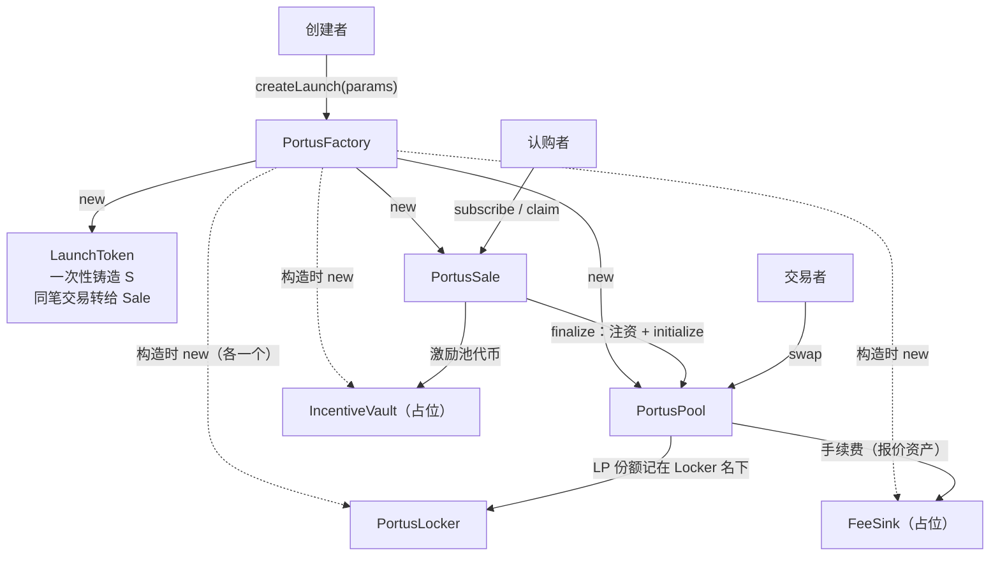
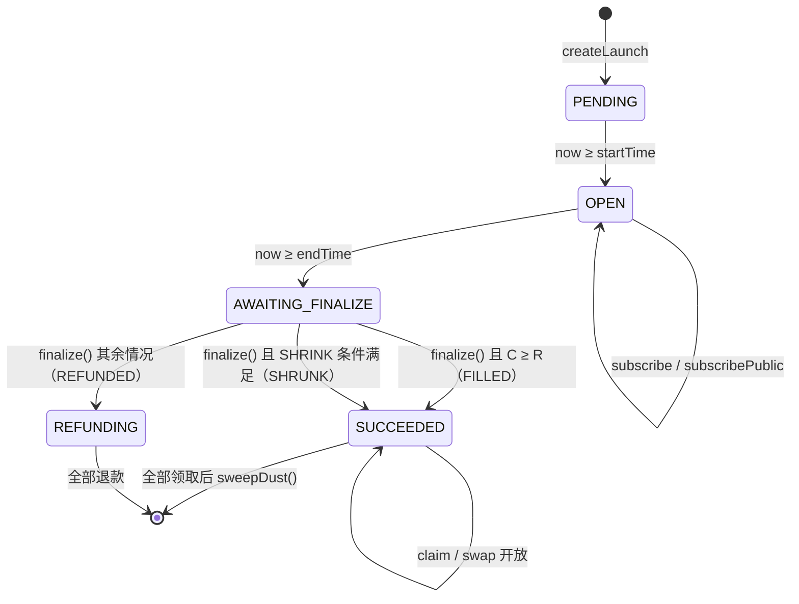
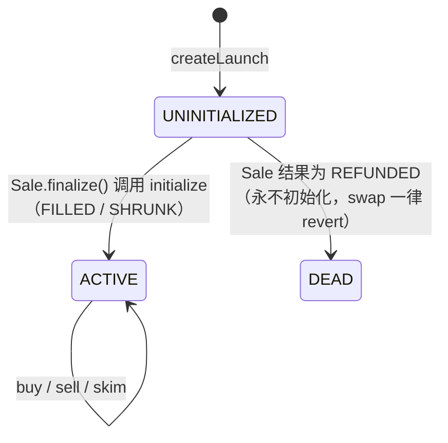

# Portus 规格（随代码维护）

> 本文件以《Lauchpad → Portus 修改方案 v1.0（2026-10-09）》为基线，下文 §0–§8 为方案原文。
> 实现时有以下**有意偏差**，以本节为准；任何后续改动请同时更新本节与代码。

## 实现偏差记录

| # | 方案原文 | 实际实现 | 原因 |
|---|---|---|---|
| X1 | `LaunchCreated` 一个事件 | 拆成 `LaunchCreated`（核心）+ `LaunchRules`（规则），索引器两者都消费 | 方案 §2.2 已允许；字段过多触发 stack-too-deep |
| X2 | Factory 内直接 `new` Token/Sale/Pool | 创建字节码放进外部链接库 `TokenDeployer` / `PoolDeployer` / `SaleDeployer`（`contracts/libraries/PortusDeployers.sol`），以 DELEGATECALL 执行，创建者仍是 Factory | 内联合计约 28.8 KB，超过 EIP-170 的 24 KB；方案 P1 验收④已允许拆部署器。库函数不可被直接调用（Solidity library call protection） |
| X3 | `QuoteAssetConfig` 五个字段 | 增加 `registered` 布尔位 | 区分"未登记"与"decimals=0"，保证 decimals 只在首次登记时固定 |
| X4 | — | Factory 增加 `launchOf(token)` 视图 | API 与 EIP-712 校验按 token 查 creator |
| X5 | FeeSink 存 `received` 统计 | **已被 P7 取代**：FeeSink 不再使用，手续费进入 `PortusFeeSplitter`（见 X24） | — |
| X6 | `ReentrancyGuardTransient`（待确认 N7） | 使用 `ReentrancyGuard`（非 transient） | N7 未确认前选不依赖 `TSTORE` 的实现；确认后可替换 |
| X7 | Pool 构造 `factory = msg.sender` | 构造参数显式传入 `factory`（由部署库传 `address(this)`，即 Factory） | 配合 X2 |
| X8 | — | `initialize` 额外拒绝 0 数量（`ZeroAmount`） | 防御性检查 |
| X9 | Sale 存储表 | 额外存 `tokensBurned`、`quoteDust` | `previewSettlement()` 结算后直接返回已记录值 |
| X10 | `publicOpenAt≠0` 时校验公开阶段 | 另加：`publicOpenAt==0 ⇒ publicCap==0`，否则 `InvalidPublicPhase` | 避免"无公开阶段却设了上限"的歧义参数 |
| X11 | EIP-712 `nonce` 类型未定 | `bytes32` 随机数；文案与白名单共用 `used_sig_nonces` | — |
| X12 | 自写 Merkle 工具 | 复用 OpenZeppelin `@openzeppelin/merkle-tree`（StandardMerkleTree，MIT），叶子编码与合约一致 | 按用户要求优先复用开源实现 |
| X13 | 索引 Locker `LiquidityLocked`、Vault `IncentiveFunded` | 不单独扫描：份额来自 Pool `Initialized`，激励额来自 Sale `Finalized` | 同一数据已在事件里，少扫两个合约 |
| X14 | Pool / Sale 行覆盖率 100% | Sale 100%；Pool 98.69%，未覆盖两行为不可达的防御分支（`KInvariant` 绊线；第三方加池时的 `ReserveOverflow`——所需代币超过总量）。`fee==0` 早退已删除 | 绊线按方案 §2.5 保留 |
| X15 | 前端 K 线 | 复用 TradingView `lightweight-charts`（Apache-2.0） | 按用户要求优先复用开源实现 |
| X16 | API `chain.ts` 提供 `readLaunch` / `readPool` 链上直读 | 列表与详情只从事件索引提供；同步失败时返回上次索引结果并带响应头 `x-portus-index: stale`。个人认购（`/subscription/:account`）、前端的池子报价、白名单根与 LP 锁定证明直接读链 | 发射参数全部不可变，由事件即可完整重建（规格 §8.2-7）；资金相关的读数仍以链上为准 |
| X17 | EIP-712 签名者 = `Factory.launchOf(token).creator`（链上读） | 取自已索引的 `LaunchCreated.creator` | 该字段不可变，与 `launchOf` 等价，少一次 RPC |
| X18 | `pricing.ts` 函数名 `getAmountOut` | `quoteBuy` / `quoteSell`（与合约同名视图一一对应），另有 `minOut` | 命名对齐合约 |
| X19 | `reset.mjs` 删除 `~/.obscura` 保护（删除前提示） | 永不删除 `~/.obscura`，只报告其中未揭示投标数 | 盐值是唯一副本，删除不可逆 |
| X20 | `.gitignore` 删除 `.launchpad/`、`contracts/.bids/` | 保留 | 旧盐值目录若仍存在，避免被误提交 |
| X21 | P0：建 git 并提交基线 | 未建提交；改为整树备份到 `D:\Lauchpad-obscura-backup` + 归档目录 | 用户此项目不使用 git |
| X23 | — | 本地链（31337）专用：网页注册 Hardhat 已解锁账户 #0–#4 作为测试钱包，详情页提供领取测试币与快进链上时间的演示工具；其他链上不注册、不显示 | 无插件即可完整演示；真实网络不存在这些操作 |
| X24 | 方案 P7：FeeSink → FeeSplitter（每币一个，见文档） | `PortusFeeSplitter` **全平台一个合约**，按池登记比例（生态 20% / 飞轮 20% / 创建者 c / 国库 60%−c），创建时写死；国库份额在 `onFee` 内实时转给该币 Treasury，其余三方记账后由收款方 `claim` 自取；skim 出的多余报价资产按手续费分账 | 用户决定（C4）：省部署 gas、Factory 体积可控 |
| X25 | 方案 N4：保价缩量时激励池按 C/R 缩放 | 按文档：激励池全额保留，只销毁 $(1-f)(1-x)S$ | 用户决定（C1） |
| X26 | 方案 D7：不开放第三方加池 | Pool 新增第三方 `addLiquidity` / `removeLiquidity`；创世 LP（`lockedShares`）由 Locker 持有，永不可赎回；手续费不进储备，第三方 LP 只从雷达 LP 挖矿获益 | 用户决定：文档要求 LP 挖矿 |
| X27 | 文档：国库"回购本币"，未写防操纵 | `PortusTreasury`（每币一个）：回购均价 ≤ 30 分钟 TWAP×1.02、单次 ≤ 余额 10%、冷却 1h、买到即销毁；观测点超过 4h 可由任何人刷新（防止长期单边行情把 TWAP 钉死）；回馈模式每 24h 把余额划入 Distributor | 推荐值；4h 刷新为本地实测发现的问题后补充 |
| X28 | 文档：飞轮回购市值前 10（7 日 TWAP + 流动性门槛），去向待定 | `PortusFlywheel`：按报价资产分别排名；每池每日检查点（任何人可调），7 日 TWAP 市值；每轮 12h 提名窗口内任何人可提名，合约保留最高的 10 个；执行时单池 ≤ 报价储备 1%、均价 ≤ 短期 TWAP×1.05，否则跳过；回购代币销毁 | 用户决定（销毁、分资产排名）；gas 有界的无许可排名 |
| X29 | 文档：Distributor 公开数据与 Merkle 根 | 单个 Distributor 管两类资金池（激励池按日释放：线性 r·S 或递减 r·剩余；国库回馈按注资）；每期根的总额 ≤ 可用额度，发布后 24h 异议期才可领取，单期领取不超过声明总额；单层邀请为链上一次性绑定；`rootPublisher` 为部署时写死的平台多签 | 推荐值；发布者在额度内决定分配，这是其持有的信任 |
| X30 | 文档：日释放率示例 0.3% | 创建参数，Factory 限制 0.1%–1%；激励池为 0 时必须为 0 | 推荐值 |
| X31 | 文档：报价资产三道检查（含价格来源） | `QuoteAssetConfig` 新增 `priceSource`、`minPoolLiquidity`（飞轮门槛）；`scripts/check-quote-asset.ts` 输出准入报告（冻结 / 增发 / rebasing 选择器扫描、代理检测、分叉上实测转账扣税与余额漂移）；交易路径仍不读预言机 | 推荐值 |
| X32 | 阶段 1 禁止主网 | 主网仍被拒绝，理由改为"未经外部审计"；审计后设 `PORTUS_MAINNET_AUDITED=yes` 方可部署 | 经济模块已补齐，剩余门槛是审计 |
| X22 | keeper 从数据库扫描 `outcome==0 && now ≥ end_time` | 直接用 `Factory.launchCount` / `launchAt` 枚举并读 `phase()` | keeper 不依赖 API 数据库即可独立运行 |

### 尚未满足的验收项

| 项 | 方案要求 | 现状 |
|---|---|---|
| Slither | P2：无未处理高/中危 | 未运行（本机未安装，安装需用户同意） |
| CI | §5.3：typecheck / build / e2e / check-messages 作为 CI 必过项，fuzz 种子写入 CI | 仓库没有 CI 配置；对应命令均已存在且本地通过（`npm run test:fuzz:ci -w @portus/contracts` 为 CI 规模） |
| 分支覆盖率 | §5.3 Sale/Pool 分支 ≥95%，总体 ≥90% | Hardhat 3 覆盖率报告只给行/语句；未测分支 |
| keeper 测试 | §5.1 链下：只对 AWAITING_FINALIZE 调用一次、失败重试不重复发送 | 奖励计算核心有单元测试；keeper 的链上任务（结算、国库、飞轮）仅在本地链实测，无自动化测试 |
| 浏览器钱包流程 | P5①：浏览器完成创建→认购→结算→领取→买卖 | ✅ 已在本地链用网页完整走通，含经济功能（领取雷达奖励、领取手续费分成、绑定邀请人）；MetaMask 等注入式钱包尚未实测 |
| P6 测试网 | 部署与源码验证 | 需用户批准后执行 |

---

# Lauchpad → Portus 修改方案（主线：白名单认购 → 结算 → 建池锁定 → 开盘价 = 认购价）

- 版本：v1.0 · 2026-10-09（北京时间）
- 依据：`/workspace/lauchpad/PLAN-zh.md`（差距分析）、Portus 文档站 `/workspace/portus-docs/`、用户已批准的决策
- 范围：**只给方案，不写代码**。本方案中的合约部分只到"接口 + 存储 + 规则 + 数学"，不含实现体。
- 仓库状态：`/workspace/lauchpad/src/` 已恢复为与 `lauchpad.zip` 逐字节一致的基线（上一步只做过安装与构建，构建产物已清理；未初始化 git，未改任何源文件）。用户电脑 `D:\Lauchpad` 未被触碰。

## 0. 已批准的决策与默认取值

| # | 决策 | 结论 | 来源 |
|---|---|---|---|
| D1 | 拍卖模型 | **删除**（commit/reveal、统一清算价、分批结算、没收） | 用户批准 |
| D2 | Agent / MCP | **冻结**：代码保留但移出主线 workspace 与构建 | 用户批准 |
| D3 | AgentRegistry / Personhood | **删除** | 用户批准 |
| D4 | 品牌 | **全量改名 Portus** | 用户批准 |
| D5 | 链 | **Robinhood Chain + 以太坊主网**（参数见 §0.1） | 用户批准 |
| D6 | AMM | **自写恒定乘积池** | 用户批准 |
| D7 | 第三方追加流动性 | 本期**不开放**（只有锁定 LP）；LP 挖矿留到后续阶段再评估 | 计划建议（默认） |
| D8 | TWAB 计算 | 后续阶段：链下索引 + Merkle 根 | 计划建议（默认） |
| D9 | 飞轮 | 后续阶段：只在同一报价资产内排名回购；回购代币销毁 | 计划建议（默认） |
| D10 | 报价资产 | **只接受 ERC-20**，ETH 走 WETH | 用户批准 |
| D11 | 平台权限 | 报价资产白名单维护者 = 平台多签（门限、是否加时间锁**待确认**） | 计划建议（默认） |
| D12 | 雷达释放口径 | 后续阶段确定 | 待确认 |

### 0.1 目标链参数（已核实部分）

| 链 | chainId | 公共 RPC | 浏览器 | 依据 | 核实情况 |
|---|---|---|---|---|---|
| Robinhood Chain（主网） | **4663** | `https://rpc.mainnet.chain.robinhood.com`（官方注明：限流，**不建议生产使用**，生产用 Alchemy 等服务商） | `https://robinhoodchain.blockscout.com` | 官方文档 docs.robinhood.com/chain/connecting/ 与 /chain/add-network-to-wallet/ | 2026-10-09 17:47（北京时间）抓取；同时对公共 RPC 调用 `eth_chainId` 返回 `0x1237` = 4663 ✅ |
| Robinhood Chain Testnet | **46630** | `https://rpc.testnet.chain.robinhood.com` | `https://explorer.testnet.chain.robinhood.com` | 同上 | `eth_chainId` 返回 `0xb626` = 46630 ✅ |
| 以太坊主网 | **1** | 不内置公共 RPC，由部署者在 `.env` 配置自己的服务商 | `https://etherscan.io` | chainlist.org/chain/1（社区注册表，ethereum-lists 数据源，非以太坊基金会官方页面）；第三方公共节点 `eth_chainId` 返回 `0x1` | ✅（以注册表 + RPC 双重核对） |
| 以太坊测试网 | — | — | — | 仓库自身注明 Sepolia 已于 2026-09-30 停止支持 | **待确认**（首选测试网改用 Robinhood Chain Testnet） |
| 各链 WETH 合约地址 | — | — | — | — | **待确认**（不凭记忆填写；部署前从官方渠道核对） |

补充：Robinhood Chain 官方文档说明它是基于 Arbitrum 的 Layer-2、以 ETH 作为 gas 代币、完全 EVM 兼容，Hardhat / viem / wagmi 可直接使用。Hardhat 3 网络配置的 `chainType` 建议用 `generic`（Arbitrum 系不是 OP Stack），需在 P0 实测确认。

### 0.2 主线全局常量（草案，均为 Factory 不可变参数）

| 常量 | 草案值 | 说明 |
|---|---|---|
| `BPS` | 10 000 | 基点 |
| `TOTAL_SUPPLY` ($S$) | $10^{9}\times10^{18}$ | **待确认**。必须能被 20 000 整除，保证两边各扣一半时无舍入（$10^{27}$ 满足） |
| 费率档 `feeBps` | {100, 200, 300, 400, 500} | 默认 100（1%） |
| `CREATOR_SHARE_MAX_BPS` | 4 000 | 占手续费；本期只存储，分账在 FeeSplitter 阶段生效 |
| `INCENTIVE_MAX_BPS` ($x_{\max}$) | 3 000 | **待确认**（文档 30% 为示例） |
| `MIN_DURATION` / `MAX_DURATION` | 1 小时 / 14 天 | **待确认**；前端默认 48 小时（示例值） |
| `MAX_START_DELAY` | 30 天 | 认购开始时间不能太远 |
| `PRICE_GRANULARITY` | $10^{6}$ | 要求约分后的价格分子 $r$ 满足 $r\cdot10^6 \le R$，把保价缩量时的报价资产零头限制在募集目标的百万分之一以内（见 §3.4） |

---

## 1. 逐文件修改清单

图例：**保留** / **修改** / **删除** / **新增** / **冻结**（移到 `frozen/`，不在 workspaces、不参与 typecheck/build/test）/ **归档**（移到 `docs/archive/obscura/` 或 `deployments/archive-obscura/`，只读保存）。

### 1.1 根目录与工程配置

| 文件 | 动作 | 具体改动 |
|---|---|---|
| `package.json` | 修改 | `name` → `portus`；`description` 改为 Portus 一句话定位；`workspaces` 改为显式列表 `["packages/shared","apps/api","apps/keeper","apps/web","contracts"]`（排除 `frozen/*`）；所有 `-w @obscura/*` → `-w @portus/*`；删除脚本：`dev:mcp`、`daemon`、`bundle`、`smoke`、`pack:mcpb`、`new-auction:*`、`drive:*`、`e2e`（旧）、`contracts:deploy:sepolia`、`contracts:deploy:base-sepolia`；新增：`contracts:deploy:robinhood-testnet`、`contracts:deploy:robinhood`、`contracts:deploy:ethereum`、`e2e`（→ 新 `scripts/e2e.ts`）、`finalize:local`（keeper 单次运行） |
| `package-lock.json` | 修改 | 改名后由 `npm install` 重新生成（不手改） |
| `tsconfig.base.json` | 保留 | — |
| `.gitignore` | 修改 | 删除 `.launchpad/`、`contracts/.bids/`、MCP 打包产物三行（随冻结目录迁移到 `frozen/mcp-server/.gitignore`）；新增 `frozen/**/dist/`；保留所有 `.env` 规则 |
| `.env.example` | 修改 | 见 §1.11 环境变量表 |
| `.env`、`.env.local-backup`、`.env.sepolia-backup` | 不纳入版本库 | 用户本地文件，方案**不读取、不修改、不复制**其中内容；P0 提醒用户自行按新变量名更新本地 `.env` |
| `.mcp.json` | 删除（移到 `frozen/mcp-server/.mcp.json.example`） | 冻结后不再在仓库根注册 MCP |
| `.claude/settings.local.json` | 修改 | 移除 `enabledMcpjsonServers: ["obscura"]`（或整个文件由用户自行决定） |
| `.codex/config.toml` | 保留 | 用户工具配置，P0 时人工确认是否含 MCP 引用 |
| `README.md` | 修改（重写） | 新主线：Portus 一句话、架构图（Factory/Sale/Pool/Locker/IncentiveVault/FeeSink）、快速开始（本地链 → 部署 → e2e）、目标链表（§0.1）、冻结与删除说明、安全模型（无管理员提款路径）、文档站链接 |
| `DEVELOPMENT.md` | 修改（重写） | 改为 Portus 阶段任务表（本方案 §7）；旧内容归档 |
| 新增 `CHANGELOG.md` | 新增 | 记录 Obscura → Portus 的破坏性变更（合约、环境变量、包名、EIP-712 domain） |
| 新增 `frozen/README.md` | 新增 | 冻结说明：冻结了什么、为什么、复活条件（需按新合约重写工具与 policy 白名单） |

### 1.2 contracts/

| 文件 | 动作 | 具体改动 |
|---|---|---|
| `contracts/package.json` | 修改 | 名称 `@portus/contracts`；依赖 `@portus/shared`；脚本：删除 `deploy:sepolia`、`deploy:base*`、`verify:sepolia`、`verify:base*`、`drive:*`、`new-auction:*`；新增 `deploy:robinhood-testnet`、`deploy:robinhood`、`deploy:ethereum`、`verify:robinhood*`、`verify:ethereum`、`e2e:local` |
| `contracts/hardhat.config.ts` | 修改 | 网络：保留 `localhost`；删除 `sepolia`、`base-sepolia`、`base`；新增 `robinhood-testnet`（46630）、`robinhood`（4663）、`ethereum`（1），RPC 一律读 env（`ROBINHOOD_TESTNET_RPC_URL`、`ROBINHOOD_RPC_URL`、`ETHEREUM_RPC_URL`），`chainType` 见 §0.1；`verify`：Robinhood 用 Blockscout（自定义 chain 配置，P0 验证 Hardhat 3 是否支持）、以太坊用 Etherscan V2 + Sourcify；保留"从根 `.env` 解析、私钥格式不对就不传"的逻辑 |
| `contracts/tsconfig.json` | 保留 | — |
| `contracts/contracts/LaunchpadAuction.sol` | **删除** | 拍卖模型整体移除（D1） |
| `contracts/contracts/AgentRegistry.sol` | **删除** | D3 |
| `contracts/contracts/IPersonhoodVerifier.sol` | **删除** | D3 |
| `contracts/contracts/MockPersonhoodVerifier.sol` | **删除** | D3 |
| `contracts/contracts/LaunchToken.sol` | 修改（重写） | 由"本地开发用 ERC-20"改为 Portus 发射代币：固定总量、构造时一次性铸给 Sale、`ERC20Burnable`、无 owner；规格见 §2.3 |
| 新增 `contracts/contracts/PortusFactory.sol` | 新增 | §2.2 |
| 新增 `contracts/contracts/PortusSale.sol` | 新增 | §2.4 |
| 新增 `contracts/contracts/PortusPool.sol` | 新增 | §2.5 |
| 新增 `contracts/contracts/PortusLocker.sol` | 新增 | §2.6 |
| 新增 `contracts/contracts/IncentiveVault.sol` | 新增（占位） | §2.7 |
| 新增 `contracts/contracts/FeeSink.sol` | 新增（占位） | §2.8；FeeSplitter 阶段替换 |
| 新增 `contracts/contracts/interfaces/IPortusFactory.sol`、`IPortusSale.sol`、`IPortusPool.sol`、`IFeeSink.sol`、`IPortusLocker.sol`、`IIncentiveVault.sol` | 新增 | 接口与事件集中定义，供 ABI 导出与后续模块引用 |
| 新增 `contracts/contracts/libraries/PortusMath.sol` | 新增 | `mulDiv`（向下/向上）、`gcd`、`sqrt`；或直接用 OZ `Math.mulDiv`/`Math.sqrt`，`gcd` 自写 |
| 新增 `contracts/contracts/test/MockERC20.sol`、`MockFeeOnTransferERC20.sol`、`MockRebasingERC20.sol`、`MockWETH.sol`、`MockReentrantERC20.sol` | 新增（仅测试） | 报价资产与异常代币测试 |
| `contracts/scripts/deploy.ts` | 修改（重写） | 部署 Locker、IncentiveVault、FeeSink、Factory（注入三者地址、`quoteAdmin`、常量）；本地额外部署 MockWETH/MockUSD 并登记为报价资产；写 `deployments/<chainId>.json`（新 schema，§1.4）；保留 `assertKeyIsSafeForChain` 与"公网需显式确认"的保护；**公网部署前打印参数并要求 `--confirm`** |
| `contracts/scripts/drive.ts` | **删除** | 拍卖推进器；结算改由 keeper 调用 `finalize()` |
| `contracts/scripts/new-auction.ts` | 修改 → 改名 `new-launch.ts` | 用当前 deployment 创建一个测试发射（读参数 JSON / CLI），生成 Merkle 根；仅本地与测试网 |
| `contracts/scripts/e2e.ts` | 修改（重写） | 本地全流程：部署 → create → 白名单认购（含超额）→ 快进 → finalize → 断言开盘价 = 认购价 → claim（代币 + 退款）→ swap 买卖 → 断言 k 不减、手续费进 FeeSink → 不满额两种规则各跑一遍 |
| `contracts/scripts/export-abi.mjs` | 修改 | `targets` 改为 `portusFactoryAbi`、`portusSaleAbi`、`portusPoolAbi`、`portusLockerAbi`、`incentiveVaultAbi`、`feeSinkAbi`、`launchTokenAbi`；注释中的包名改 `@portus/contracts` |
| 新增 `contracts/scripts/merkle.ts` | 新增 | 从 CSV（地址, 上限）生成根与证明 JSON（与前端/API 共用 `packages/shared/src/merkle.ts`） |
| `contracts/test/launchpad.test.ts` | **删除** | 旧拍卖/注册表测试 |
| `contracts/test/batch-settlement.test.ts` | **删除** | 同上 |
| `contracts/test/settlement.fuzz.test.ts` | **删除**（写法参考保留到新 fuzz） | 同上 |
| 新增 `contracts/test/helpers/fixture.ts` | 新增 | 沿用现有风格：`network.connect()`、`viem.deployContract`、`jumpTo`、`expectCustom`；Merkle 工具 |
| 新增 `contracts/test/factory.test.ts`、`token.test.ts`、`sale.subscribe.test.ts`、`sale.settle.test.ts`、`sale.claim.test.ts`、`pool.test.ts`、`locker-vault-sink.test.ts`、`permissions.test.ts` | 新增 | §5 |
| 新增 `contracts/test/invariants.fuzz.test.ts` | 新增 | §5.2 |

### 1.3 packages/shared/

| 文件 | 动作 | 具体改动 |
|---|---|---|
| `package.json` | 修改 | `@portus/shared` |
| `src/abi.ts` | 修改（重新生成） | 由新 `export-abi.mjs` 生成；删除 `agentRegistryAbi`、`launchpadAuctionAbi` |
| `src/chains.ts` | 修改 | 保留 31337；删除 11155111、84532、8453；新增 46630、4663、1（字段按 §0.1，`endOfLife: null`，`faucetUrl` 待确认）；注释注明来源与核实时间；`ChainConfig` 新增 `kind: "l1" \| "arbitrum-l2" \| "local"`、`wethAddress: Address \| null`（待确认前为 null）；保留 `WELL_KNOWN_DEV_ADDRESSES` 与 `assertKeyIsSafeForChain` |
| `src/addresses.ts` | 修改 | `Deployment` 改为 `{ factory, locker, incentiveVault, feeSink }`；`loadDeployment` 读 `PORTUS_FACTORY_ADDRESS` 等；`DeploymentFile` 新 schema（§1.4）；`deploymentMismatchWarning` 改比较 `factory` |
| `src/types.ts` | 修改 | 删除 `AuctionPhase`、`LocalCommitRecord`、拍卖相关 `LaunchOnchainFacts`；新增 `SalePhase = "PENDING" \| "OPEN" \| "AWAITING_FINALIZE" \| "SUCCEEDED" \| "REFUNDING"`（与合约枚举一一对应）、`UnderfillRule = "REFUND" \| "SHRINK"`、`LaunchParams`、`LaunchOnchainFacts`（token、sale、pool、quoteAsset、raiseTarget、totalCommitted、priceNum/priceDen、phase、reserves、opening 结果）、`SubscriptionRecord`、`SwapRecord`；保留 `UntrustedLaunchCopy`（文案仍视为不可信） |
| `src/schemas.ts` | 修改 | 删除 `commitBidInputSchema`、`revealBidInputSchema`、`auctionIdSchema`、`analyzeLaunchInputSchema`、`listLaunchesInputSchema`（随 MCP 冻结）；新增 `launchKeySchema`（token 地址）、`whitelistEntrySchema`、`whitelistUploadSchema`、`launchSchema`（新字段） |
| `src/logs.ts` | 保留 | 分块扫日志逻辑复用 |
| `src/env.ts` | 保留 | `legacyEnv` 机制保留（用于少数改名变量的过渡） |
| `src/index.ts` | 修改 | 新增导出 `merkle.ts`、`pricing.ts` |
| 新增 `src/merkle.ts` | 新增 | 叶子编码 `keccak256(bytes.concat(keccak256(abi.encode(account, cap))))`（OZ 双哈希风格）、建树、取证明；与合约一致的单元测试 |
| 新增 `src/pricing.ts` | 新增 | 纯函数：`splitSupply(S, xBps)`、`raiseFromFdv`、`reducedPrice(R, Qsale)`、`settle(C, R, rule, …)`、`allocation(c_i, …)`、`getAmountOut`；与合约规则逐条对应（前端、API、keeper、测试共用），并有 TS 单测与合约结果对拍 |

### 1.4 deployments/

| 文件 | 动作 | 具体改动 |
|---|---|---|
| `deployments/11155111.json`、`31337.json`、`localhost.json` | 归档 → `deployments/archive-obscura/` | 旧拍卖地址只读保存 |
| 新 `deployments/<chainId>.json` | 新增（部署时生成） | `{ chainId, network, factory, locker, incentiveVault, feeSink, quoteAdmin, quoteAssets: [{address, symbol, freezable}], deployer, deployedAt, startBlock, gitCommit }` |

### 1.5 scripts/（根）

| 文件 | 动作 | 具体改动 |
|---|---|---|
| `scripts/sync-env.mjs` | 修改 | 写入 `PORTUS_FACTORY_ADDRESS`、`PORTUS_LOCKER_ADDRESS`、`PORTUS_INCENTIVE_VAULT_ADDRESS`、`PORTUS_FEE_SINK_ADDRESS`、`NEXT_PUBLIC_PORTUS_FACTORY_ADDRESS`；清理 `OBSCURA_*`/`LAUNCHPAD_*`/`AGENT_REGISTRY_ADDRESS`；删除"bidder 私钥是 Hardhat 默认 key"提示 |
| `scripts/preflight.mjs` | 修改 | 检查项改为：deployer、keeper 两个角色的余额与是否为开发私钥；`deployments/<id>.json` 的 factory 与 `.env` 是否一致；删除 bidder 检查 |
| `scripts/reset.mjs` | 修改 | 删除 `~/.obscura` 未揭示投标保护（MCP 冻结）——**但在删除前提示用户先确认旧 Sepolia 部署上没有未揭示投标**；其余清理逻辑保留，路径改为新产物 |

### 1.6 apps/api/

| 文件 | 动作 | 具体改动 |
|---|---|---|
| `package.json` | 修改 | `@portus/api`；依赖 `@portus/shared` |
| `src/clearing.ts` | **删除** | 统一清算价计算不再需要 |
| `src/chain.ts` | 修改（重写） | `FACTORY_ADDRESS`；`readLaunch(token)`（Factory/Sale/Pool 视图）、`launchCount()`、`readPool(pool)`；删除 `readAuction*`、`auctionCount`、`computeClearingPrice` 导出；保留 `chainNowSeconds`/`refreshChainTime` |
| `src/indexer.ts` | 修改（重写） | 事件见 §6.1；去重表与进度表按 `(chain_id, contract_address)` 维度；Factory 发现新 Sale/Pool 后动态加入扫描集合 |
| `src/indexer-runtime.ts` | 修改 | 用 Factory 地址与 `startBlock` 初始化；多合约扫描 |
| `src/db.ts` | 修改 | 表结构见 §6.2；删除 `indexed_auctions`、`indexed_commits`；`launch_copy` 改以 `(chain_id, token)` 为主键 |
| `src/auth.ts` | 修改 | EIP-712 domain：`name: "Portus Launch Copy"`、`verifyingContract = factory`；类型 `LaunchCopyAuthorization { token, copyHash, nonce }`；签名者必须是 `Factory.launchOf(token).creator`；新增 `WhitelistAuthorization { token, root, listHash, nonce }` 用于创建者上传白名单 |
| `src/app.ts` | 修改 | 路由见 §6.3；删除拍卖字段；保留 `cors`、zod 校验、不可信文案回退文本（改为 Portus 文案） |
| `src/index.ts` | 修改 | 删除 `derivePhase`（拍卖版）；改为 `deriveSalePhase(row, now)`，与 `PortusSale.phase()` 一致；启动日志文字改 Portus |
| `src/seed.ts` | 修改 | 给 e2e/本地部署创建的发射写入演示文案（以 token 地址为键） |
| `src/auth.test.ts` | 修改 | 用例改为 token 维度 + 白名单上传签名 |
| `src/indexer.test.ts` | 修改 | 用新事件序列验证：创建 → 认购 → 结算 → 领取 → swap 的聚合结果、重放幂等 |
| `tsconfig.json` | 保留 | — |

### 1.7 apps/keeper/

| 文件 | 动作 | 具体改动 |
|---|---|---|
| `package.json` | 修改 | `@portus/keeper` |
| `src/index.ts` | 修改（重写） | 从"分批结算拍卖"改为：扫描 `phase == AWAITING_FINALIZE` 的 Sale 并调用 `finalize()`；对"全部已领取且有零头"的 Sale 调用 `sweepDust()`；后续阶段再加国库回购/飞轮/Merkle 根发布。保留 RPC/私钥校验、`assertKeyIsSafeForChain`、分块日志扫描、等待交易回执后再进行下一步（吸取 Sepolia 实测教训） |

### 1.8 apps/web/

| 文件 | 动作 | 具体改动 |
|---|---|---|
| `package.json` | 修改 | `@portus/web` |
| `app/layout.tsx` | 修改 | metadata/页头/页脚改 Portus；导航：首页、创建、文档（外链 Portus 文档站）；删除"下载 MCP" |
| `app/page.tsx`、`app/live-index.tsx` | 修改 | 列表字段改为：代币、报价资产、募集目标/已认购、阶段、开盘价、池子储备；删除"本站只读"说明块 |
| `app/providers.tsx` | 修改 | wagmi 链改为 `hardhat`、Robinhood Chain Testnet、Robinhood Chain、Ethereum（Robinhood 用 `defineChain` 按 §0.1 定义） |
| `app/create/create-auction-form.tsx` | 删除 → 新增 `app/create/create-launch-form.tsx` | 表单字段见 §6.4；调用 `Factory.createLaunch`；上传白名单并签 EIP-712；文案签名沿用 |
| `app/create/page.tsx` | 修改 | 引用新表单 |
| `app/launch/[id]/page.tsx`、`live-launch.tsx` | 删除 → 新增 `app/launch/[token]/page.tsx`、`live-launch.tsx`、`subscribe-panel.tsx`、`claim-panel.tsx`、`swap-panel.tsx` | 主线所需最小交互：认购（自动取证明、approve + subscribe）、领取、简易买卖（显示手续费与往返成本）、冻结风险提示 |
| `app/download/page.tsx`、`app/download/mcp/route.ts` | **删除**（冻结） | MCP 下载随 D2 移除 |
| `components/obscura/*` | 修改 → 目录改名 `components/portus/*` | `phase-badge.tsx` 改为 Sale 五阶段；`untrusted.tsx` 保留（项目文案仍不可信）；其余改名 |
| `components/ui/*` | 保留 | — |
| `i18n/*` | 保留 | — |
| `lib/api.ts` | 修改 | 类型与 API 对齐 §6.3；`formatEth` 改为按报价资产 `decimals` 格式化；新增 `roundTripCost(feeBps)` |
| `messages/en.json`、`messages/zh.json` | 修改 | 见 §6.5 |
| `scripts/check-messages.mjs`、`scripts/contrast.mjs` | 保留 | — |
| `AGENTS.md`、`CLAUDE.md`、`COMPONENTS.md` | 修改 | 删除"禁止 mint/投标按钮"原则，改为"所有链上动作必须明文展示参数；不可信文案围栏保留" |
| `globals.css`、`components.json`、`next.config.ts`、`postcss.config.mjs`、`tsconfig.json`、`next-env.d.ts` | 保留 | 品牌配色可在 UI 阶段再调 |

### 1.9 packages/mcp-server/（冻结）

| 文件 | 动作 | 具体改动 |
|---|---|---|
| 整个目录 | **冻结** → `frozen/mcp-server/` | 原样移动，不改代码；从 workspaces 移除（因而不参与 `npm install` 链接、typecheck、build、test）；新增 `frozen/mcp-server/FROZEN.md`：说明其依赖旧拍卖 ABI，复活需要（1）重写工具为 `list_launches`/`analyze_launch`/`subscribe`/`claim`/`swap`，（2）更新 `policy.ts` 的 `ALLOWED` 白名单与目标解析，（3）保留 smoke 中两条安全断言 |
| `docs/install-claude-desktop.md` | 冻结 → `frozen/mcp-server/docs/` | — |

### 1.10 docs/

| 文件 | 动作 | 具体改动 |
|---|---|---|
| `whitepaper.md` | 修改（重写） | 改为 Portus 白皮书摘要 + 指向文档站（白皮书、核心机制、合约架构）；注明合约未部署/未审计；旧 Obscura 白皮书归档 |
| `audit-scope.md` | 修改（重写） | 新调用图、不变量（§5.2）、资金流、信任假设、自识别高风险区（§8） |
| `runbook.md` | 修改 | 部署（Robinhood Testnet 优先）、验证（Blockscout/Etherscan）、keeper 运行、监控（未 finalize 的 Sale、FeeSink 余额） |
| `testnet.md` | 修改（重写） | Robinhood Chain Testnet 流程；以太坊测试网待确认 |
| `key-management.md` | 修改 | 角色只剩 deployer、keeper、quoteAdmin 多签；删除 bidder/MCP 签名器部分（移入冻结目录） |
| `demo-sepolia.md` | 归档 | Sepolia 已停止支持 |
| `personhood.md` | 删除 | D3 |
| `mvp-runbook.md`、`next-ui-tasks.md`、`rebrand-frontend-tasks.md`、`rebrand-status.md` | 归档 | Obscura 阶段文档 |
| `Obscura-投资人简介-A4.pdf`、`Obscura-投资人简介-手机版.pdf`、`build-investor-pdf.py` | 归档 | 待 Portus 版本替代 |
| 新增 `docs/portus-spec.md` | 新增 | 本方案的合约规格部分（§2–§4）随代码一起维护 |

### 1.11 环境变量与包名

| 旧 | 新 | 说明 |
|---|---|---|
| 根包 `obscura` | `portus` | — |
| `@obscura/shared`、`@obscura/api`、`@obscura/keeper`、`@obscura/web`、`@obscura/contracts` | `@portus/*` 同名 | npm scope 可用性需用户确认 |
| `@obscura/mcp` | 保留原名于 `frozen/`（不发布） | 冻结 |
| `OBSCURA_AUCTION_ADDRESS`、`NEXT_PUBLIC_OBSCURA_AUCTION_ADDRESS`、`OBSCURA_REGISTRY_ADDRESS` | 删除 | — |
| — | `PORTUS_FACTORY_ADDRESS`、`PORTUS_LOCKER_ADDRESS`、`PORTUS_INCENTIVE_VAULT_ADDRESS`、`PORTUS_FEE_SINK_ADDRESS`、`NEXT_PUBLIC_PORTUS_FACTORY_ADDRESS` | 新增 |
| `SEPOLIA_RPC_URL`、`BASE_SEPOLIA_RPC_URL`、`BASE_RPC_URL`、`BASESCAN_API_KEY` | 删除 | — |
| — | `ROBINHOOD_TESTNET_RPC_URL`、`ROBINHOOD_RPC_URL`、`ETHEREUM_RPC_URL`、`BLOCKSCOUT_API_KEY`（若需要） | 新增 |
| `ETHERSCAN_API_KEY`、`DEPLOYER_PRIVATE_KEY`、`CHAIN_ID`、`RPC_URL`、`API_PORT`、`DATABASE_PATH`、`NEXT_PUBLIC_API_URL`、`NEXT_PUBLIC_CHAIN_ID`、`NEXT_PUBLIC_RPC_URL` | 保留 | — |
| `KEEPER_PRIVATE_KEY` | 保留（`.env.example` 中补上） | keeper 已在用 |
| `COMMIT_MINUTES`、`REVEAL_MINUTES`、`SEED_DEMO_AUCTION` | 删除 → 新增 `SALE_MINUTES`、`SEED_DEMO_LAUNCH` | 本地演示用 |
| `OBSCURA_PRIVATE_KEY`、`OBSCURA_API_URL`、`OBSCURA_MAX_SPEND_WEI` | 移入 `frozen/mcp-server/.env.example` | 冻结 |
| — | `PORTUS_QUOTE_ADMIN` | 部署时写入 Factory 的报价资产白名单维护者（多签地址） |
| EIP-712 domain `"Agent Launchpad Copy"` | `"Portus Launch Copy"` | 旧签名全部失效（合约也换了，无影响） |
| 本地状态目录 `~/.obscura` | 不再使用 | 冻结；删除前确认无未揭示投标 |

---

## 2. 合约规格（只给接口与规则，不含实现体）

### 2.1 总体结构与部署关系



设计要点：

1. **Locker / IncentiveVault / FeeSink 由 Factory 构造函数内部 `new` 出来**，它们的 `factory` 是 `msg.sender`，从而避免"先部署 A 再回填 B 地址"的一次性初始化管理员函数。
2. 每次 `createLaunch` 在**同一笔交易**里部署 Token、Sale、Pool，并在 Locker/Vault/Sink 中登记 Pool 与 Sale。
3. 全部合约**无 owner、无代理、无暂停、无升级**。唯一的特权角色是 Factory 的 `quoteAdmin`（只维护报价资产白名单，影响仅限**之后**的新发射）。
4. 编译器 `0.8.28`、OZ `5.x`（沿用现仓库）；`SafeERC20`、`ReentrancyGuardTransient`（需确认目标链支持 Cancun `TSTORE`；若不支持改用 `ReentrancyGuard`，**P0 待确认**）。
5. 阶段 1 的 FeeSink、IncentiveVault 没有提取路径，**只能部署到本地链与测试网**；主网部署必须等 FeeSplitter（P2）与 Distributor（P4）替换后的 Factory 版本。

### 2.2 PortusFactory

**不可变量（immutable）**

| 名称 | 类型 | 说明 |
|---|---|---|
| `quoteAdmin` | `address` | 报价资产白名单维护者（多签，构造参数，非零） |
| `locker` | `IPortusLocker` | 构造时 `new PortusLocker()` |
| `incentiveVault` | `IIncentiveVault` | 构造时 `new IncentiveVault()` |
| `feeSink` | `IFeeSink` | 构造时 `new FeeSink()` |

常量见 §0.2（`TOTAL_SUPPLY`、`BPS`、费率档、上限、时长、`PRICE_GRANULARITY`）。

**存储**

```solidity
struct QuoteAssetConfig {
    bool    allowed;      // 是否允许新发射使用
    bool    freezable;    // 资产发行方能否冻结地址（如稳定币黑名单），仅用于前端风险提示
    uint8   decimals;     // 登记时从 token 读取并固定
    uint128 minFdv;       // 以该资产最小单位计的 FDV 下限
    uint128 maxFdv;       // FDV 上限；须满足 maxFdv 对应的募集目标 < 2^112
}

struct Launch {
    address creator;
    address token;
    address sale;
    address pool;
    address quoteAsset;
    uint64  createdAt;
}

mapping(address quoteAsset => QuoteAssetConfig) public quoteAssets;
Launch[] internal _launches;                       // launchId = 下标
mapping(address token => uint256 launchIdPlusOne) public launchIdOf;
mapping(address => bool) public isSale;            // 供 Vault/Sink/Locker 校验调用者
mapping(address => bool) public isPool;
```

**创建参数**

```solidity
enum UnderfillRule { REFUND, SHRINK }

struct LaunchParams {
    string  name;            // 1..32 字节
    string  symbol;          // 1..11 字节
    address quoteAsset;      // 必须 quoteAssets[..].allowed
    uint256 raiseTarget;     // R，报价资产最小单位
    uint16  feeBps;          // ∈ {100,200,300,400,500}
    uint16  creatorShareBps; // ≤ 4000；阶段 1 只记录（FeeSplitter 阶段使用）
    uint16  incentiveBps;    // X ≤ 3000（待确认）；可为 0，切分见 §3.1
    uint64  startTime;       // ≥ block.timestamp 且 ≤ block.timestamp + 30 days
    uint64  duration;        // [1 hours, 14 days]（待确认）
    bytes32 merkleRoot;      // 白名单根；0 表示无白名单
    uint64  publicOpenAt;    // 0 = 无公开阶段；否则 ∈ [startTime, startTime+duration)
    uint256 publicCap;       // 公开阶段每地址上限；publicOpenAt≠0 时必须 > 0
    UnderfillRule underRule;
    uint16  minFillBps;      // 仅 SHRINK 有效；0 = 不设下限；≤ 10000
    uint8   treasuryMode;    // 阶段 1 只记录（Treasury 阶段使用），取值范围待定
    bytes32 metadataHash;    // 链下文案哈希（可为 0），API 用于核验
}
```

**参数校验（全部在 `createLaunch` 中，失败即 revert）**

| 规则 | 错误 |
|---|---|
| `quoteAssets[q].allowed` | `QuoteAssetNotAllowed(q)` |
| `feeBps ∈ {100,200,300,400,500}` | `InvalidFeeTier(feeBps)` |
| `creatorShareBps ≤ 4000` | `CreatorShareTooHigh()` |
| `incentiveBps ≤ INCENTIVE_MAX_BPS` | `IncentiveTooHigh()` |
| `Q_sale = S·(B−X)/(2B)` 整除（$S=10^{27}$ 能被 20000 整除，恒成立；保留断言） | — |
| `R > 0` 且 `R < 2^112` | `InvalidRaiseTarget()` |
| `minFdv·Q_sale ≤ R·S ≤ maxFdv·Q_sale`（交叉相乘，避免除法） | `FdvOutOfBounds()` |
| 约分：`g=gcd(R,Q_sale)`、`r=R/g`、`s=Q_sale/g`，要求 `r·PRICE_GRANULARITY ≤ R` | `PriceNotGranular(r)` |
| 时间：`now ≤ startTime ≤ now+30d`，`duration ∈ [MIN,MAX]` | `InvalidSchedule()` |
| `merkleRoot==0 ⇒ publicOpenAt==startTime`（无白名单必须从开始就公开） | `NoSubscriptionPath()` |
| `publicOpenAt≠0 ⇒ startTime ≤ publicOpenAt < endTime 且 publicCap>0` | `InvalidPublicPhase()` |
| `minFillBps ≤ 10000`；`underRule==REFUND ⇒ minFillBps==0` | `InvalidUnderfill()` |
| 名称/符号长度 | `InvalidMetadata()` |

**函数**

```solidity
// 任何人可调用
function createLaunch(LaunchParams calldata p)
    external returns (uint256 launchId, address token, address sale, address pool);

// 只读
function launchCount() external view returns (uint256);
function launchAt(uint256 launchId) external view returns (Launch memory);
function previewPrice(uint256 raiseTarget, uint16 incentiveBps)
    external pure returns (uint256 qSale, uint256 qLp, uint256 qInc, uint256 r, uint256 s);

// 仅 quoteAdmin；只影响之后的 createLaunch，已存在的发射不受影响
function setQuoteAsset(address asset, bool allowed, bool freezable, uint128 minFdv, uint128 maxFdv) external;
```

`setQuoteAsset` 额外规则：首次登记时读取并固定 `decimals`（要求 `≤ 18`，否则 `UnsupportedDecimals`）；`minFdv ≤ maxFdv`（`InvalidFdvBounds`）；募集额 `R<2^112` 在创建时另行检查；**不提供删除历史发射、修改已发射参数的任何入口**。

**`createLaunch` 执行顺序**

1. 校验参数，计算 `qSale,qLp,qInc,r,s`。
2. `token = new LaunchToken(name, symbol, S, address(this))`（先铸给 Factory 自身）。
3. `pool = new PortusPool(token, quoteAsset, feeBps, locker, feeSink)`（`factory = msg.sender`）。
4. `sale = new PortusSale(...)`（构造参数含 token、pool 与全部不可变规则）。
5. `pool.bindSale(sale)`：仅 factory、只能一次，绑定唯一可调用 `initialize` 的地址。
6. `token.safeTransfer(sale, S)`，断言 `balanceOf(sale)==S`、`balanceOf(factory)==0`。
7. `isSale[sale]=true`、`isPool[pool]=true`；`locker.registerPool(pool, token)`；`incentiveVault.registerSale(sale, token)`；`feeSink.registerPool(pool, token, quoteAsset)`。
8. 记录 `Launch`，emit `LaunchCreated`。

> 用 `bindSale` 一次性绑定来打破 Pool↔Sale 的循环依赖；它只在 `createLaunch` 同一笔交易内被调用，外部无法利用。

**事件**

```solidity
event QuoteAssetSet(address indexed asset, bool allowed, bool freezable, uint8 decimals, uint128 minFdv, uint128 maxFdv);
event LaunchCreated(
    uint256 indexed launchId, address indexed creator, address indexed token,
    address sale, address pool, address quoteAsset,
    uint256 raiseTarget, uint256 qSale, uint256 qLp, uint256 qInc,
    uint256 priceNum, uint256 priceDen,       // r, s
    uint16 feeBps, uint16 creatorShareBps, uint16 incentiveBps,
    uint64 startTime, uint64 endTime, uint64 publicOpenAt, uint256 publicCap,
    bytes32 merkleRoot, uint8 underRule, uint16 minFillBps, uint8 treasuryMode,
    bytes32 metadataHash);
```

> `LaunchCreated` 字段较多，若触发 stack-too-deep，拆成 `LaunchCreated(核心)` + `LaunchRules(规则)` 两个事件，索引器两者都消费。

**错误**：上表各项 + `NotQuoteAdmin()`、`ZeroAddress()`、`UnsupportedDecimals()`、`InvalidFdvBounds()`。

### 2.3 LaunchToken

| 项 | 规格 |
|---|---|
| 继承 | `ERC20`、`ERC20Burnable`（`ERC20Permit` 可选，**待定**） |
| 构造 | `constructor(string name, string symbol, uint256 totalSupply, address recipient)`：`_mint(recipient, totalSupply)`；recipient = Factory，同一笔交易内整笔转给 Sale |
| 小数位 | 18 |
| 权限 | **无 owner、无 mint、无暂停、无黑名单、无转账税** |
| 事件/错误 | 仅 ERC-20 标准 |

不变量：`totalSupply()` 只减不增；`createLaunch` 返回时 `balanceOf(sale) == S`。

### 2.4 PortusSale

**不可变量**：`factory, token, quoteAsset, pool, incentiveVault, feeSink, creator, raiseTarget(R), qSale, qLp, qInc, priceNum(r), priceDen(s), startTime, endTime, publicOpenAt, publicCap, merkleRoot, underRule, minFillBps`。

**存储**

```solidity
enum Phase { PENDING, OPEN, AWAITING_FINALIZE, SUCCEEDED, REFUNDING }
enum Outcome { NONE, FILLED, SHRUNK, REFUNDED }   // FILLED: C ≥ R

uint256 public totalCommitted;                         // C
uint256 public subscriberCount;                        // n
uint256 public claimedCount;
mapping(address => uint256) public committed;          // c_i（白名单 + 公开合计）
mapping(address => uint256) public whitelistCommitted; // 校验白名单上限
mapping(address => uint256) public publicCommitted;    // 校验公开上限
mapping(address => bool)    public claimed;

Outcome public outcome;
// finalize 时写入的结算结果
uint256 public poolQuote;        // 注入池子的报价资产
uint256 public poolTokens;       // 注入池子的代币
uint256 public tokensForClaims;  // 预留给认购者的代币上限（Σ 应得 ≤ 此值）
uint256 public quoteForRefunds;  // 预留给退款的报价资产上限
uint256 public incentiveFunded;  // 转入 IncentiveVault 的代币
bool    public dustSwept;
```

`phase()` 为纯视图：`outcome==REFUNDED ⇒ REFUNDING`；`outcome∈{FILLED,SHRUNK} ⇒ SUCCEEDED`；否则按时间 `now<start ⇒ PENDING`、`now<end ⇒ OPEN`、否则 `AWAITING_FINALIZE`。

**函数**

```solidity
// 认购者本人；phase()==OPEN；白名单通道
function subscribe(uint256 amount, uint256 cap, bytes32[] calldata proof) external;
// 认购者本人；phase()==OPEN 且 now ≥ publicOpenAt ≠ 0
function subscribePublic(uint256 amount) external;
// 任何人；phase()==AWAITING_FINALIZE；只能成功一次
function finalize() external;
// 本人或任何人代领（资产只发给 account）；phase() ∈ {SUCCEEDED, REFUNDING}
function claim() external returns (uint256 tokens, uint256 refund);
function claimFor(address account) external returns (uint256 tokens, uint256 refund);
// 任何人；SUCCEEDED 且 claimedCount == subscriberCount 且 !dustSwept
function sweepDust() external;

// 只读
function phase() external view returns (Phase);
function previewClaim(address account) external view returns (uint256 tokens, uint256 refund);
function previewSettlement() external view
    returns (Outcome o, uint256 poolQuote_, uint256 poolTokens_, uint256 burn_, uint256 toVault_, uint256 quoteDust_);
```

**认购规则**

- 白名单叶子：`leaf = keccak256(bytes.concat(keccak256(abi.encode(account, cap))))`（OZ `MerkleProof` 推荐的双哈希，防第二原像）。`whitelistCommitted[a] + amount ≤ cap`。
- 公开：`publicCommitted[a] + amount ≤ publicCap`。
- `amount > 0`；`committed[a]==0` 时 `subscriberCount++`。
- 资金：`safeTransferFrom(msg.sender, this, amount)`，用**余额差**校验实际到账 `== amount`，否则 `UnsupportedQuoteToken()`（拒绝转账税/通缩代币）。
- **认购不可撤回**（与 Portus 文档"认购后到结束前不能退出"一致；若要支持撤回为**待定**）。
- `totalCommitted + amount` 不设全局上限（超额按比例退款）；防溢出由 `uint256` 与 `R<2^112` 保证（单个 `c_i·qSale ≤ 2^256`：需要 `C < 2^256/10^27 ≈ 1.15·10^50`，在 `subscribe` 断言 `totalCommitted ≤ MAX_TOTAL_COMMIT = 2^160`，`TotalCommitTooLarge`）。

**finalize 规则**（数学见 §3）

| 条件 | outcome | 动作 |
|---|---|---|
| `C ≥ R` | `FILLED` | 向 Pool 转 `R` 报价资产 + `qLp` 代币，`pool.initialize(R, qLp)`；`qInc` 转 Vault 并 `notifyFunded`；`tokensForClaims=qSale`、`quoteForRefunds=C−R` |
| `C < R`，`underRule==SHRINK`，`C·B ≥ R·minFillBps`，`k=⌊C/r⌋ ≥ 1` | `SHRUNK` | 向 Pool 转 `k·r` 与 `k·s`，`initialize(kr, ks)`；`C−kr` 报价零头立即转 FeeSink；`tokensForClaims=⌊C·s/r⌋`；激励 `⌊qInc·C/R⌋` 转 Vault（**缩放口径待确认**）；其余代币当场 `burn` |
| 其余（`C<R` 且 REFUND，或 SHRINK 不满足下限，或 `k=0`，或 `C==0`） | `REFUNDED` | 当场 `burn` 全部 `S`；`quoteForRefunds=C` |

`finalize` 在一笔交易内完成**注资 + 初始化 + 激励转入 + 销毁**；Pool 在 `initialize` 前一律拒绝交易，因此**不存在开盘前抢跑窗口**。

**claim 规则**

| outcome | `tokens_i` | `refund_i` |
|---|---|---|
| FILLED | `⌊c_i·qSale / C⌋` | `⌊c_i·(C−R) / C⌋` |
| SHRUNK | `⌊c_i·s / r⌋` | 0 |
| REFUNDED | 0 | `c_i` |

用 OZ `Math.mulDiv`（向下取整）。`claimed[a]=true` 后转账（CEI + `nonReentrant`）；`committed[a]==0` 时 `NothingToClaim`。

**sweepDust**：把 Sale 剩余代币余额全部 `burn`，剩余报价资产余额（结算零头 + 任何人误转入的捐赠）转 FeeSink。只在所有认购者都已领取后可调用，**因此任何零头都不可能侵占未领取者的份额**；不存在"超时没收"。

**事件**

```solidity
event Subscribed(address indexed account, uint256 amount, uint256 totalForAccount, uint256 totalCommitted, bool viaWhitelist);
event Finalized(uint8 indexed outcome, uint256 totalCommitted, uint256 poolQuote, uint256 poolTokens,
                uint256 tokensForClaims, uint256 quoteForRefunds, uint256 incentiveFunded, uint256 tokensBurned, uint256 quoteDustToSink);
event Claimed(address indexed account, uint256 tokens, uint256 refund, address indexed caller);
event DustSwept(uint256 tokensBurned, uint256 quoteToSink);
```

**错误**：`NotOpen()`、`PublicNotOpen()`、`InvalidProof()`、`CapExceeded(uint256 cap, uint256 wouldBe)`、`ZeroAmount()`、`UnsupportedQuoteToken()`、`TotalCommitTooLarge()`、`NotAwaitingFinalize()`、`NotSettled()`、`NothingToClaim()`、`AlreadyClaimed()`、`ClaimsOutstanding()`、`AlreadySwept()`。

**状态机**



> `PENDING / OPEN / AWAITING_FINALIZE` 由时间推导，不需要交易推动；只有 `finalize()` 是写状态的转换，且任何人可调用（keeper 只是"热心人"，不是必要角色）。

### 2.5 PortusPool（自写恒定乘积池，单池单交易对）

**不可变量**：`factory, token, quoteAsset, locker, feeSink, feeBps`；`sale` 为存储变量，由 `bindSale` 一次性写入。

**存储**

```solidity
uint112 private reserveQuote;
uint112 private reserveToken;
uint32  private blockTimestampLast;
uint256 public  priceQuoteCumulativeLast;  // UQ112x112，quote/token，允许溢出（同 UniV2）
uint256 public  priceTokenCumulativeLast;
uint256 public  totalShares;               // 只在 initialize 时铸造一次
mapping(address => uint256) public sharesOf; // 唯一持有人 = locker
bool    public  initialized;
```

**函数**

```solidity
// 仅 factory；只能一次（createLaunch 内调用）
function bindSale(address sale) external;
// 仅 sale；只能一次；调用前 sale 已转入资产；要求 balance ≥ amount
function initialize(uint256 quoteAmount, uint256 tokenAmount) external returns (uint256 shares);

// 任何人；initialized；now ≤ deadline；to ∉ {pool, token, quoteAsset, 0}
function buy(uint256 quoteIn, uint256 minTokensOut, address to, uint256 deadline) external returns (uint256 tokensOut);
function sell(uint256 tokensIn, uint256 minQuoteOut, address to, uint256 deadline) external returns (uint256 quoteOut);

// 任何人：把超出储备的余额清走（报价资产 → FeeSink；代币 → burn）
function skim() external;

// 只读
function getReserves() external view returns (uint112 quoteReserve, uint112 tokenReserve, uint32 ts);
function quoteBuy(uint256 quoteIn) external view returns (uint256 tokensOut, uint256 fee);
function quoteSell(uint256 tokensIn) external view returns (uint256 quoteOut, uint256 fee);
```

**明确不提供**：`removeLiquidity`、`addLiquidity`（初始化后）、份额转让/授权、闪电贷、`sync`（用 `skim` 代替，储备只由 swap 改变）、任何管理函数、改费率入口。

**定价与手续费（$B=10^4$，$f=$feeBps）**

- 买（报价资产 → 代币）：
  $fee=\lceil q_{in} f / B\rceil$，$q_{net}=q_{in}-fee$，
  $t_{out}=\left\lfloor \dfrac{q_{net}\,T}{Q+q_{net}}\right\rfloor$，
  新储备 $(Q+q_{net},\ T-t_{out})$。
- 卖（代币 → 报价资产）：
  $q_{gross}=\left\lfloor \dfrac{t_{in}\,Q}{T+t_{in}}\right\rfloor$，
  $fee=\lceil q_{gross} f / B\rceil$，$q_{out}=q_{gross}-fee$，
  新储备 $(Q-q_{gross},\ T+t_{in})$。
- 手续费**只以报价资产收取**，买入在输入端扣、卖出在毛输出端扣，`safeTransfer` 给 FeeSink（阶段 1 只转账，不回调；FeeSplitter 阶段再加 `IFeeSink.onFee` 钩子，**TODO**）。
- 每次 swap 后断言 $Q'T' \ge QT$（由向下取整保证；保留断言作防御，`KInvariant`）。
- 输入用余额差校验（`UnsupportedToken`）；新储备 `< 2^112`（`ReserveOverflow`）；`t_out==0`/`q_out==0` → `InsufficientOutput`；滑点 → `SlippageExceeded(minOut, out)`；过期 → `Expired()`。
- `_update` 与 UniV2 相同：区块内首次更新时累加 `UQ112x112(Q/T)·Δt` 与 `UQ112x112(T/Q)·Δt`，供后续国库/飞轮做 TWAP。

**初始化**：`shares = Math.sqrt(quoteAmount·tokenAmount)`，`sharesOf[locker]=shares`，`locker.notifyLocked(shares)`；不设 `MINIMUM_LIQUIDITY`（没有撤池路径，不存在首个 LP 操纵份额的攻击面）。

**事件**

```solidity
event Initialized(uint256 quoteReserve, uint256 tokenReserve, uint256 shares, address indexed locker);
event Swap(address indexed sender, address indexed to, bool indexed isBuy,
           uint256 amountIn, uint256 amountOut, uint256 feeQuote, uint112 quoteReserve, uint112 tokenReserve);
event FeePaid(address indexed sink, uint256 amount);
event Skimmed(uint256 quoteToSink, uint256 tokensBurned);
```

**错误**：`NotFactory()`、`SaleAlreadyBound()`、`NotSale()`、`AlreadyInitialized()`、`NotInitialized()`、`InsufficientInitialBalance()`、`Expired()`、`InvalidRecipient()`、`ZeroAmount()`、`InsufficientOutput()`、`SlippageExceeded(uint256,uint256)`、`ReserveOverflow()`、`UnsupportedToken()`、`KInvariant()`。

**状态机**



### 2.6 PortusLocker

| 项 | 规格 |
|---|---|
| 不可变量 | `factory`（= 部署者 Factory） |
| 存储 | `mapping(address pool => address token) public tokenOfPool; mapping(address pool => uint256) public lockedShares;` |
| 函数 | `registerPool(address pool, address token)`：仅 factory；`notifyLocked(uint256 shares)`：仅已登记 pool、仅一次 |
| 明确不提供 | 任何转出、撤池、授权、`execute`/`call`、所有权转移函数 |
| 事件 | `PoolRegistered(address indexed pool, address indexed token)`、`LiquidityLocked(address indexed pool, uint256 shares)` |
| 错误 | `NotFactory()`、`UnknownPool()`、`AlreadyLocked()` |

说明：Pool 份额只在 Pool 内部记账且 Pool 不提供转移/撤池，所以"锁定"在 Pool 层已经成立；Locker 是**显式、可审计的记录所有人**，便于前端展示与以后（若要）加入手续费领取，而不是安全边界本身。

### 2.7 IncentiveVault（占位，Distributor 阶段替换）

| 项 | 规格 |
|---|---|
| 不可变量 | `factory` |
| 存储 | `mapping(address sale => address token) public tokenOfSale; mapping(address token => uint256) public funded;` |
| 函数 | `registerSale(address sale, address token)`：仅 factory；`notifyFunded(uint256 amount)`：仅已登记 sale，校验余额增量 ≥ amount |
| 阶段 1 | **没有任何提取函数**；代币只进不出 → 只能用于本地/测试网 |
| 阶段 4 | 由带每日释放 + Merkle 领取的 `Distributor` 替换（新 Factory 版本）；释放口径（线性/递减）**待确认** |
| 事件 | `SaleRegistered(address indexed sale, address indexed token)`、`IncentiveFunded(address indexed token, uint256 amount)` |
| 错误 | `NotFactory()`、`UnknownSale()`、`FundingMismatch()` |

### 2.8 FeeSink（占位）与 IFeeSink

| 项 | 规格 |
|---|---|
| 不可变量 | `factory` |
| 存储 | `mapping(address pool => address token) public tokenOfPool; mapping(address quoteAsset => uint256) public received;`（仅统计） |
| 函数 | `registerPool(address pool, address token, address quoteAsset)`：仅 factory |
| 阶段 1 | 被动接收报价资产（swap 手续费、结算零头、skim 余额），**无提取函数** |
| `IFeeSink`（接口，阶段 2 实现） | `function onFee(address token, address quoteAsset, uint256 amount) external;` —— FeeSplitter 按创建时锁定的四方比例（创建者 `creatorShareBps`、国库、生态 20%、飞轮 20%，具体以白皮书为准）实时记账；**TODO** |
| 事件 | `PoolRegistered(address indexed pool, address indexed token, address indexed quoteAsset)` |

---

## 3. 结算数学与取整（精确规则 + 证明）

记号：$B=10^4$；$S=10^{27}$；$X=$`incentiveBps`；$R=$募集目标；$C=\sum_i c_i$；$n=$认购人数。所有除法均为整数除法，$\lfloor\cdot\rfloor$ 向下、$\lceil\cdot\rceil$ 向上。

### 3.1 供应切分（激励池"两边各扣一半"）

$$
Q_{sale}=Q_{LP}=\frac{S(B-X)}{2B},\qquad Q_{inc}=\frac{S\,X}{B},\qquad Q_{sale}+Q_{LP}+Q_{inc}=S .
$$

因 $2B=20000$ 整除 $S=10^{27}$，三者都是**精确整数**，无取整。若以后修改 $S$，Factory 必须保留 `S % (2B) == 0` 的断言。

### 3.2 认购价的约分表示

$$
p=\frac{R}{Q_{sale}},\quad g=\gcd(R,Q_{sale}),\quad r=\frac{R}{g},\quad s=\frac{Q_{sale}}{g},\quad p=\frac{r}{s},\ \gcd(r,s)=1 .
$$

创建时要求 $r\cdot10^{6}\le R$（`PRICE_GRANULARITY`），等价于 $g\ge10^6$。含义：价格可被"$g$ 份完全相同的小单位"整除，保价缩量时报价零头不超过 $R/10^6$。前端在用户输入 FDV 后自动把 $R$ 调整到满足该条件的最近值并显示。FDV 由 $F=p\cdot S=R\,S/Q_{sale}=2RB/(B-X)$ 给出（展示用，链上只用交叉相乘比较边界）。

### 3.3 满额（$C\ge R$，`FILLED`）

- 池子注入：$(Q_{pool},T_{pool})=(R,\ Q_{LP})$。
- 激励：$Q_{inc}$ 全额转 IncentiveVault。
- 认购者 $i$：
  $$tokens_i=\left\lfloor\frac{c_i\,Q_{sale}}{C}\right\rfloor,\qquad refund_i=\left\lfloor\frac{c_i\,(C-R)}{C}\right\rfloor .$$
- **偿付性**：$\sum tokens_i\le Q_{sale}$，$\sum refund_i\le C-R$（每项向下取整），Sale 的余额永远足以支付所有领取。
- **零头**：$0\le Q_{sale}-\sum tokens_i<n$，$0\le (C-R)-\sum refund_i<n$（每项截断损失 $<1$）。代币零头在 `sweepDust` 时销毁，报价零头转 FeeSink。
- **每个认购者的成交价不低于 $p$**：实付 $paid_i=c_i-refund_i\ge c_i-\frac{c_i(C-R)}{C}=\frac{c_iR}{C}$，且 $tokens_i\le\frac{c_iQ_{sale}}{C}$，故
  $$\frac{paid_i}{tokens_i}\ \ge\ \frac{c_iR/C}{c_iQ_{sale}/C}=\frac{R}{Q_{sale}}=p .$$
  取整误差只会让单人多付不到 1 个最小单位的报价资产、少拿不到 1 个最小单位的代币，**不会让任何人以低于 $p$ 的价格拿到代币**。
- $C=R$ 是特例：$refund_i=0$，$tokens_i=\lfloor c_iQ_{sale}/R\rfloor$。

### 3.4 不满额 · 保价缩量（$C<R$，`SHRINK`，`SHRUNK`）

触发条件：`underRule == SHRINK`、$C\cdot B\ge R\cdot$`minFillBps`、$k\ge1$，其中
$$A=C,\qquad k=\left\lfloor\frac{A}{r}\right\rfloor .$$

- 池子注入：$(Q_{pool},T_{pool})=(k\,r,\ k\,s)$，价格 $\dfrac{kr}{ks}=\dfrac{r}{s}=p$，**精确相等**。
- 报价零头：$d=A-kr$，$0\le d<r\le R/10^6$，`finalize` 时直接转 FeeSink。
- 认购者 $i$：$tokens_i=\left\lfloor\dfrac{c_i\,s}{r}\right\rfloor$，$refund_i=0$（全额按价成交）。
  - 单人成交价 $c_i/tokens_i\ge r/s=p$。
  - 预留 $tokens_{claims}=\lfloor C s/r\rfloor\ge\sum tokens_i$，零头 $<n$，`sweepDust` 销毁。
- **可行性**：$C<R=g\,r\Rightarrow k\le g-1$，$\Rightarrow ks< gs=Q_{LP}$；且 $\lfloor Cs/r\rfloor< gs=Q_{sale}$。所以 Sale 手里的代币足够。
- 销毁（`finalize` 当场）：$(Q_{sale}-\lfloor Cs/r\rfloor)+(Q_{LP}-ks)+(Q_{inc}-Q'_{inc})$。
- 激励（**默认口径，待确认**）：$Q'_{inc}=\left\lfloor Q_{inc}\cdot\dfrac{C}{R}\right\rfloor$，与发射规模同比例缩小，避免"募得少、激励抛压却不变"。备选口径：全额保留 / 全部销毁。
- 退化：若 $k=0$（$C<r$）或低于 `minFillBps`，改走 §3.5 全额退款。

**为什么需要 $r\le R/10^6$**：缩量时必须向池子注入 $r$ 的整数倍才能保证价格**精确**为 $r/s$；剩下的 $d<r$ 无处可放（放进池子会改变价格、退给某个人又不公平），只能作为零头进 FeeSink。粒度条件把它限制为募集目标的百万分之一以内。

### 3.5 不满额 · 全额退款（`REFUNDED`）

$tokens_i=0$，$refund_i=c_i$，$\sum refund_i=C$，**无零头**；`finalize` 当场销毁全部 $S$；Pool 永不初始化。$C=0$ 时同样进入此结果（无人认购，只销毁）。

### 3.6 定理：开盘价 = 认购价

开盘前池子不可交易（`NotInitialized`），初始化与注资在 `finalize` 同一笔交易完成，初始化后的第一笔 swap 看到的边际价格为
- FILLED：$\dfrac{R}{Q_{LP}}=\dfrac{R}{Q_{sale}}=p$（因 $Q_{LP}=Q_{sale}$，这正是激励池两边各扣一半的作用）；
- SHRUNK：$\dfrac{kr}{ks}=p$。

Pool 用内部储备而不是 `balanceOf` 定价，所以 `finalize` 前后任何人往池子地址转币都不改变开盘价（多余余额只能被 `skim` 清走：报价资产进 FeeSink、代币销毁）。∎

反例对照（文档已说明）：若激励只从 LP 侧扣，开盘价变为 $p/(1-2x)$，$x=30\%$ 时为 $2.5p$。

### 3.7 池子交易取整方向（偏向池子）

| 量 | 取整 | 理由 |
|---|---|---|
| 手续费 | 向上 | 不会因取整少收手续费 |
| 买入输出 $t_{out}$ | 向下 | $(Q+q_{net})(T-t_{out})\ge QT$ |
| 卖出毛输出 $q_{gross}$ | 向下 | $(Q-q_{gross})(T+t_{in})\ge QT$ |
| 初始份额 $\sqrt{QT}$ | 向下 | 仅记录，无撤池 |

推论：$k=QT$ 单调不减；手续费不进入储备（与 UniV2 不同，费用直接转 FeeSink），所以 $k$ 的增长只来自取整。交易者一次买入再全部卖出的往返成本约为 $1-(1-f)^2\approx2f$（前端展示）。

### 3.8 算例（WETH 报价，18 位小数）

参数：$R=10\ \text{WETH}=10^{19}$，$X=3000$。
- $Q_{sale}=Q_{LP}=3.5\times10^{26}$，$Q_{inc}=3\times10^{26}$。
- $g=10^{19}$，$r=1$，$s=3.5\times10^{7}$（每 1 wei WETH 对应 $3.5\times10^7$ 个代币最小单位），满足粒度条件。

**超额**：三人认购 $c=(10\times10^{18},\ 7\times10^{18}+3,\ 8\times10^{18}-3)$，$C=25\times10^{18}$。
- 代币：$1.4\times10^{26}$、$98000000000000000042000000$、$111999999999999999958000000$，合计恰为 $Q_{sale}$，代币零头 0。
- 退款：$6\times10^{18}$、$4200000000000000001$、$4799999999999999998$，合计 $15\times10^{18}-1$，报价零头 1 wei → FeeSink。
- 池子：$(10^{19},\ 3.5\times10^{26})$，开盘价 $=p$。

**保价缩量**：$C=4.2\times10^{18}+7$。$k=C$（因 $r=1$），池子 $(4200000000000000007,\ 147000000000000000245000000)$，报价零头 0；认购者合计拿 $147000000000000000245000000$；激励转入 $\lfloor Q_{inc}C/R\rfloor=126000000000000000210000000$；其余销毁。

> 这些数值由 `packages/shared/src/pricing.ts` 与合约测试共同对拍（§5.1 用例 S-07/S-12）。

---

## 4. 权限表与被删除的特权路径

### 4.1 权限矩阵（阶段 1 主线）

| 操作 | 创建者 | quoteAdmin（多签） | keeper | 任何人 | 合约内部 | 备注 |
|---|:-:|:-:|:-:|:-:|:-:|---|
| `Factory.createLaunch` | ✅ | ✅ | ✅ | ✅ | — | 无许可；参数受 Factory 边界约束 |
| `Factory.setQuoteAsset` | ❌ | ✅ | ❌ | ❌ | — | **只影响之后的新发射**；不能改已存在发射的任何参数 |
| 修改已创建发射的任何参数（费率、分账、R、x、规则、白名单根、时间） | ❌ | ❌ | ❌ | ❌ | ❌ | 全部不可变 |
| `Sale.subscribe` / `subscribePublic` | 与其他人相同 | 同左 | 同左 | ✅（白名单/上限内） | — | 创建者没有任何认购特权 |
| `Sale.finalize` | ✅ | ✅ | ✅ | ✅ | — | 时间到即可；keeper 只是兜底调用者 |
| `Sale.claim` / `claimFor` | 本人 | — | 可代领（资产只发给本人） | 可代领 | — | — |
| `Sale.sweepDust` | ✅ | ✅ | ✅ | ✅ | — | 仅全部领取完毕后；去向固定（销毁 / FeeSink） |
| 提取募集款 | ❌ | ❌ | ❌ | ❌ | Sale → Pool | 募集款**只能**进池子或退给认购者 |
| `Pool.bindSale` | ❌ | ❌ | ❌ | ❌ | Factory（一次） | — |
| `Pool.initialize` | ❌ | ❌ | ❌ | ❌ | Sale（一次） | — |
| `Pool.buy` / `sell` / `skim` | ✅ | ✅ | ✅ | ✅ | — | — |
| 撤出流动性 / 转让 LP 份额 | ❌ | ❌ | ❌ | ❌ | ❌ | 不存在该函数 |
| 改费率 / 暂停交易 / 升级 | ❌ | ❌ | ❌ | ❌ | ❌ | 不存在该函数 |
| `Locker.registerPool`、`Vault.registerSale`、`FeeSink.registerPool` | ❌ | ❌ | ❌ | ❌ | Factory | — |
| `Locker.notifyLocked` | ❌ | ❌ | ❌ | ❌ | 已登记 Pool（一次） | — |
| `Vault.notifyFunded` | ❌ | ❌ | ❌ | ❌ | 已登记 Sale | — |
| 从 FeeSink / IncentiveVault 提取 | ❌ | ❌ | ❌ | ❌ | ❌ | 阶段 1 无提取路径（故仅限测试网），P2/P4 替换 |
| 代币增发 / 黑名单 / 暂停 | ❌ | ❌ | ❌ | ❌ | ❌ | LaunchToken 无 owner |

**链下角色**

| 角色 | 能做 | 不能做 |
|---|---|---|
| API / 索引器 | 存储并分发白名单证明、项目文案（经创建者 EIP-712 签名） | 不能改链上根；前端必须用链上 `merkleRoot` 本地校验证明 |
| keeper | 调用 `finalize`、`sweepDust`、`claimFor` | 没有任何合约特权；宕机只会延后，不会损失资金 |
| 部署者私钥 | 部署 Factory | 部署后无任何权限 |

### 4.2 明确删除的特权路径（来自 Obscura）

| 旧路径 | 位置 | 旧行为 | 风险 | Portus 中的去向 |
|---|---|---|---|---|
| `withdrawProceeds(auctionId)` | `LaunchpadAuction.sol` | 创建者在结算后把全部募集 ETH 提到自己地址 | 典型"卷款"路径；与非托管定位冲突 | **删除**。募集款在 `finalize` 中只能进池子（$R$ 或 $kr$）或退给认购者；零头只能进 FeeSink |
| `reclaimUnsold(auctionId)` | 同上 | 创建者取回未售出代币及按比例取整的代币零头 | 创建者可在开盘后抛售未售份额 | **删除**。未售代币与零头一律 `burn` |
| `sweepForfeited(auctionId, bidders)` | 同上 | 创建者把未揭示投标者的押金并入募集款 | 没收用户资金；与固定价认购无关 | **删除**。Portus 无押金、无没收；未领取的份额永远可领 |
| `AgentRegistry` 的 `onlyOwner` 函数：`setPersonhoodVerifier`、`setQuotaOverride`、`setParameters` | `AgentRegistry.sol` | owner 可换真人验证器、给任意地址改配额、改质押与冷却参数 | 中心化准入、可单方面改变规则 | **随 AgentRegistry 整体删除**（D3）；准入改为每个发射创建时固定的 Merkle 根 |
| `MockPersonhoodVerifier.setVerified` | `MockPersonhoodVerifier.sol` | 任何人都能把任意地址设为已验证（测试用） | 若误部署到公网即为后门 | **删除** |
| MCP `policy.ts` 的签名器 + 消费上限 | `packages/mcp-server` | 本地私钥代签交易 | 私钥托管在 agent 进程 | **冻结**（D2），不随 Portus 发布 |

### 4.3 剩余的信任假设（需写入文档与审计范围）

1. `quoteAdmin` 能决定**今后**哪些报价资产可用以及 FDV 边界；若被盗，最坏结果是允许一个恶意 ERC-20 作为**新**发射的报价资产（不影响已有发射）。缓解：多签 + 前端只展示经人工复核的资产 + 资产登记事件监控。
2. 报价资产本身（WETH 无冻结；稳定币类资产可冻结 Pool/Sale 地址）——`freezable` 标志用于前端风险提示，合约无法防御。
3. 阶段 1 的 FeeSink/IncentiveVault 无提取路径——资金会被永久锁定，因此**禁止主网部署阶段 1 合约**。

---

## 5. 测试计划

沿用现有体系：Hardhat 3 + viem + `node:test`（`network.connect()`、`viem.deployContract`、时间跳转、`expectCustom` 断言自定义错误）；覆盖率用 `hardhat test --coverage`。TS 侧（shared/api/keeper）用 `node --test`。

### 5.1 单元用例

**Factory（F）**

| 编号 | 用例 |
|---|---|
| F-01 | 正常创建：一笔交易产生 Token/Sale/Pool；`balanceOf(sale)==S`、`balanceOf(factory)==0`；`LaunchCreated` 字段与 `previewPrice` 一致 |
| F-02 | 各边界逐项 revert：费率不在档位、`creatorShareBps=4001`、`incentiveBps>上限`、`R=0`、`R≥2^112`、FDV 越界（上下各一）、粒度不足（构造 `r·10^6>R`）、开始时间在过去/超 30 天、时长 < 1h / > 14d、无白名单且无公开阶段、公开阶段时间越界、`publicCap=0`、REFUND 时 `minFillBps≠0`、名称/符号长度 |
| F-03 | 边界值恰好通过：`feeBps=100/500`、`creatorShareBps=4000`、`X=0`、`X=上限`、`duration=1h/14d`、`startTime=now`、`now+30d` |
| F-04 | 未登记 / 已禁用报价资产 revert；`setQuoteAsset` 非 quoteAdmin revert；禁用资产后**已存在**发射照常认购、结算、交易 |
| F-05 | `setQuoteAsset` 固定 decimals；decimals>18 revert；`minFdv>maxFdv` revert |
| F-06 | `Locker/Vault/Sink` 的 factory 为本 Factory；登记表正确；第三方直接调用登记函数 revert |
| F-07 | `Pool.bindSale` 二次调用 / 非 factory 调用 revert |

**LaunchToken（T）**：T-01 总量与持有人；T-02 无 mint/owner（ABI 中不存在相关选择器，测试断言 ABI）；T-03 `burn` 使总量下降。

**Sale 认购（S）**

| 编号 | 用例 |
|---|---|
| S-01 | PENDING 时认购 revert `NotOpen`；结束后 revert |
| S-02 | 白名单：正确证明通过；错误 cap / 他人证明 / 篡改证明 revert `InvalidProof`；多次认购累计到 cap 恰好通过、超 1 wei revert `CapExceeded` |
| S-03 | 公开阶段：`publicOpenAt` 前 revert；之后按 `publicCap` 限额；白名单额度与公开额度分别计数 |
| S-04 | `merkleRoot==0` 时 `subscribe` 一律 revert，`subscribePublic` 从开始即可用 |
| S-05 | 转账税代币 / 余额差不符 revert `UnsupportedQuoteToken`（MockFeeOnTransferERC20） |
| S-06 | `subscriberCount` 只在首次认购时 +1；事件字段正确 |

**Sale 结算与领取**

| 编号 | 用例 |
|---|---|
| S-07 | §3.8 超额算例逐数值对拍（代币、退款、零头、池子储备） |
| S-08 | $C=R$ 精确满额：无退款，代币零头 < n |
| S-09 | 单人认购超额 |
| S-10 | REFUND 规则不满额：全额退款、`totalSupply` 归零、Pool `NotInitialized` |
| S-11 | $C=0$：`finalize` 成功、全部销毁 |
| S-12 | §3.8 保价缩量算例对拍（含 $r>1$ 的第二组参数，验证 $d=C-kr$ 进入 FeeSink 且 $d<r$） |
| S-13 | SHRINK 低于 `minFillBps` → REFUNDED；恰好等于 → SHRUNK |
| S-14 | SHRINK 且 $k=0$ → REFUNDED |
| S-15 | `finalize` 早于 endTime revert；二次调用 revert |
| S-16 | 开盘价：FILLED / SHRUNK 后 `getReserves()` 满足 `Q·s == T·r` |
| S-17 | finalize 前向 Pool / Sale 捐赠报价资产与（无法获得的）代币：开盘价不变；`skim` / `sweepDust` 正确处理 |
| S-18 | claim：结算前 revert；二次 revert；未认购 revert；`claimFor` 资产只到账给本人 |
| S-19 | `sweepDust`：仍有人未领取 revert `ClaimsOutstanding`；全部领取后销毁与转出金额 = 预期零头；二次 revert |
| S-20 | 激励：FILLED 时 Vault 收到 $Q_{inc}$；SHRUNK 时收到 $\lfloor Q_{inc}C/R\rfloor$；`X=0` 时不调用 |
| S-21 | 重入：恶意报价资产（MockReentrantERC20）在 `transfer` 回调中重入 `claim` / `finalize` / `buy` 全部 revert |

**Pool（P）**

| 编号 | 用例 |
|---|---|
| P-01 | 未初始化时 buy/sell revert；非 sale 调用 `initialize` revert；二次初始化 revert |
| P-02 | 初始化份额 = `sqrt(Q·T)`，`sharesOf(locker)`，Locker 事件 |
| P-03 | buy/sell 输出与 TS `pricing.ts` 对拍（多组费率 100–500） |
| P-04 | 手续费向上取整：`q_in=1` 时 fee=1、`t_out=0` revert `InsufficientOutput` |
| P-05 | 滑点、过期、`to` 非法地址 revert |
| P-06 | 储备上溢 revert `ReserveOverflow`（构造接近 2^112 的报价资产） |
| P-07 | `skim`：多余报价资产进 FeeSink、多余代币销毁 |
| P-08 | TWAP 累计值与 UniV2 公式对拍（跨区块） |
| P-09 | 往返交易：买入再全部卖出，损失 ≥ 两次手续费之和（$k$ 不减） |

**权限（A）**：A-01 遍历全部合约 ABI，断言**不存在**以下选择器：`withdrawProceeds`、`reclaimUnsold`、`sweepForfeited`、`removeLiquidity`、`transferOwnership`、`owner`、`pause`、`upgradeTo*`、`mint`、`setFee*`；A-02 每个"仅 X 可调用"函数用非 X 账户调用均 revert；A-03 FeeSink、IncentiveVault 没有任何会转出资产的外部函数（ABI 级断言 + 人工审查）。

**链下（TS）**：`merkle.ts` 与合约对拍；`pricing.ts` 单测；API 索引器重放幂等、断点续扫、Factory 新发射动态加入扫描；EIP-712 文案/白名单签名必须来自创建者；keeper 只对 `AWAITING_FINALIZE` 调用一次、交易失败重试且不会重复发送。

### 5.2 不变量 / 模糊测试

实现方式：沿用旧 `settlement.fuzz.test.ts` 的"随机序列 + 断言"写法（`node:test` 中用可复现种子的 PRNG 生成 N≥500 组随机发射与操作序列）；如后续引入 Foundry，可把同一组性质改写为 `invariant_*`（可选，**待定**）。

| 编号 | 性质 |
|---|---|
| I-01 | **偿付性**：任意时刻 `quote.balanceOf(sale) ≥ Σ_{未领取} refund_i`，`token.balanceOf(sale) ≥ Σ_{未领取} tokens_i` |
| I-02 | **守恒**：$\sum c_i = Q_{pool}+\sum refund_i+$报价零头（FILLED / SHRUNK / REFUNDED 三种结果分别验证） |
| I-03 | **代币守恒**：$S = T_{pool,0}+\sum tokens_i+Q'_{inc}+$已销毁 |
| I-04 | **开盘价**：初始化后首个区块内 $Q\cdot s = T\cdot r$ |
| I-05 | **不低价**：每个认购者 $paid_i\cdot s \ge tokens_i\cdot r$ |
| I-06 | **零头上界**：FILLED 两侧零头 $<n$；SHRUNK 报价零头 $<r\le R/10^6$ |
| I-07 | **k 单调**：任意 swap 序列中 $Q\cdot T$ 不减 |
| I-08 | **储备一致**：`balanceOf(pool) ≥ reserve`（两种资产） |
| I-09 | **LP 永久锁定**：`sharesOf(locker) == totalShares` 恒成立，且 Pool 中没有其他持有人 |
| I-10 | **总量单调**：`token.totalSupply()` 从不增加 |
| I-11 | **单次结算**：`outcome` 一旦非 NONE 不再变化；Pool 至多初始化一次 |
| I-12 | **无特权提款**：任何非认购者地址在整个序列中从 Sale 收到的报价资产只能是 FeeSink 收到的零头 |

### 5.3 覆盖率目标

| 范围 | 行 | 分支 |
|---|---|---|
| `PortusSale`、`PortusPool` | 100% | ≥ 95% |
| `PortusFactory`、`LaunchToken`、`PortusLocker`、`IncentiveVault`、`FeeSink` | ≥ 95% | ≥ 90% |
| 合约总体 | ≥ 95%（现基线 90.24%） | ≥ 90% |
| `packages/shared`（merkle/pricing） | ≥ 95% | — |
| `apps/api`（索引器、鉴权、路由） | ≥ 85% | — |

另：`npm run typecheck`、web `build`、`scripts/e2e.ts` 本地全流程、`check-messages.mjs`（en/zh 键一致）作为 CI 必过项；Slither 静态分析无高/中危未处理项。

---

## 6. API / 索引器 / keeper / 前端（主线部分）

### 6.1 需要索引的事件

| 合约 | 事件 | 用途 |
|---|---|---|
| Factory | `QuoteAssetSet` | 报价资产表（前端下拉、`freezable` 风险提示） |
| Factory | `LaunchCreated`（若拆分则加 `LaunchRules`） | 新建 `launches` 行；把 `sale`、`pool` 动态加入扫描集合 |
| Sale | `Subscribed` | 认购明细、实时进度、人数 |
| Sale | `Finalized` | 结果、池子初始储备、销毁量、零头 |
| Sale | `Claimed` | 领取进度（keeper 判断能否 `sweepDust`） |
| Sale | `DustSwept` | 收尾 |
| Pool | `Initialized` | 开盘价、份额 |
| Pool | `Swap` | 成交明细、K 线、成交量、手续费统计 |
| Pool | `Skimmed`、`FeePaid` | FeeSink 收入统计 |
| Locker | `LiquidityLocked` | 锁定证明展示 |
| IncentiveVault | `IncentiveFunded` | 激励池余额展示 |

扫描策略：沿用 `packages/shared/src/logs.ts` 的分块扫描；`indexer_progress` 以 `(chain_id, contract_address)` 为键；先扫 Factory，再按 `launches` 表把 Sale/Pool 地址批量传给 `getLogs({ address: [...] })`；全部写入在单个 SQLite 事务里完成，并用 `indexed_events` 去重（重放幂等）。读取 `Finalized` 后不再依赖 RPC 视图推导结果。

### 6.2 数据库表（node:sqlite）

```sql
-- 删除：indexed_auctions、indexed_commits；launch_copy / used_copy_nonces 改键

CREATE TABLE quote_assets (
  chain_id INTEGER NOT NULL, address TEXT NOT NULL,
  allowed INTEGER NOT NULL, freezable INTEGER NOT NULL, decimals INTEGER NOT NULL,
  min_fdv TEXT NOT NULL, max_fdv TEXT NOT NULL, symbol TEXT,
  PRIMARY KEY (chain_id, address));

CREATE TABLE launches (
  chain_id INTEGER NOT NULL, token TEXT NOT NULL, launch_id INTEGER NOT NULL,
  creator TEXT NOT NULL, sale TEXT NOT NULL, pool TEXT NOT NULL, quote_asset TEXT NOT NULL,
  raise_target TEXT NOT NULL, q_sale TEXT NOT NULL, q_lp TEXT NOT NULL, q_inc TEXT NOT NULL,
  price_num TEXT NOT NULL, price_den TEXT NOT NULL,
  fee_bps INTEGER NOT NULL, creator_share_bps INTEGER NOT NULL, incentive_bps INTEGER NOT NULL,
  start_time INTEGER NOT NULL, end_time INTEGER NOT NULL, public_open_at INTEGER NOT NULL,
  public_cap TEXT NOT NULL, merkle_root TEXT NOT NULL, under_rule INTEGER NOT NULL,
  min_fill_bps INTEGER NOT NULL, treasury_mode INTEGER NOT NULL, metadata_hash TEXT NOT NULL,
  total_committed TEXT NOT NULL DEFAULT '0', subscriber_count INTEGER NOT NULL DEFAULT 0,
  claimed_count INTEGER NOT NULL DEFAULT 0,
  outcome INTEGER NOT NULL DEFAULT 0,           -- 0 NONE / 1 FILLED / 2 SHRUNK / 3 REFUNDED
  pool_quote TEXT, pool_tokens TEXT, tokens_burned TEXT, quote_dust TEXT, incentive_funded TEXT,
  reserve_quote TEXT, reserve_token TEXT, last_swap_block TEXT,
  created_block TEXT NOT NULL, created_tx TEXT NOT NULL,
  PRIMARY KEY (chain_id, token));
CREATE UNIQUE INDEX launches_sale ON launches(chain_id, sale);
CREATE UNIQUE INDEX launches_pool ON launches(chain_id, pool);

CREATE TABLE subscriptions (
  chain_id INTEGER NOT NULL, token TEXT NOT NULL, account TEXT NOT NULL,
  committed TEXT NOT NULL, whitelist_committed TEXT NOT NULL, public_committed TEXT NOT NULL,
  claimed INTEGER NOT NULL DEFAULT 0, tokens_claimed TEXT, refund_claimed TEXT,
  PRIMARY KEY (chain_id, token, account));

CREATE TABLE swaps (
  chain_id INTEGER NOT NULL, pool TEXT NOT NULL, block_number TEXT NOT NULL, log_index INTEGER NOT NULL,
  tx_hash TEXT NOT NULL, ts INTEGER NOT NULL, trader TEXT NOT NULL, recipient TEXT NOT NULL,
  is_buy INTEGER NOT NULL, amount_in TEXT NOT NULL, amount_out TEXT NOT NULL, fee_quote TEXT NOT NULL,
  reserve_quote TEXT NOT NULL, reserve_token TEXT NOT NULL,
  PRIMARY KEY (chain_id, pool, block_number, log_index));
CREATE INDEX swaps_ts ON swaps(chain_id, pool, ts);

CREATE TABLE whitelist_entries (            -- 创建者签名上传；链上根一致才对外提供
  chain_id INTEGER NOT NULL, token TEXT NOT NULL, account TEXT NOT NULL,
  cap TEXT NOT NULL, proof_json TEXT NOT NULL,
  PRIMARY KEY (chain_id, token, account));

CREATE TABLE launch_copy (
  chain_id INTEGER NOT NULL, token TEXT NOT NULL,
  name TEXT NOT NULL, symbol TEXT NOT NULL, description TEXT NOT NULL,
  docs_url TEXT, image_url TEXT, copy_hash TEXT NOT NULL, updated_at INTEGER NOT NULL,
  PRIMARY KEY (chain_id, token));

CREATE TABLE used_sig_nonces (              -- 文案与白名单上传共用
  chain_id INTEGER NOT NULL, factory TEXT NOT NULL, signer TEXT NOT NULL, nonce TEXT NOT NULL,
  kind TEXT NOT NULL, token TEXT NOT NULL, payload_hash TEXT NOT NULL, used_at INTEGER NOT NULL,
  PRIMARY KEY (chain_id, factory, signer, nonce));

CREATE TABLE indexed_events (
  chain_id INTEGER NOT NULL, contract_address TEXT NOT NULL,
  block_number TEXT NOT NULL, log_index INTEGER NOT NULL,
  PRIMARY KEY (chain_id, contract_address, block_number, log_index));
CREATE TABLE indexer_progress (
  chain_id INTEGER NOT NULL, contract_address TEXT NOT NULL, indexed_block TEXT NOT NULL,
  PRIMARY KEY (chain_id, contract_address));
```

所有金额以十进制字符串存储（沿用现有做法，避免 JS 精度问题）。旧库不迁移：Portus 部署使用新的 `DATABASE_PATH`（默认 `./data/portus.sqlite`）。

### 6.3 API 路由（Hono）

| 方法 | 路径 | 说明 |
|---|---|---|
| GET | `/health` | 增加 `factory`、`chainId`、`indexedBlock`、`deploymentMismatch` |
| GET | `/quote-assets` | 可用报价资产（含 `freezable`、`decimals`、FDV 边界） |
| GET | `/launches?phase=&quote=&cursor=` | 列表；`phase` 由 `deriveSalePhase` 计算，与链上 `phase()` 同逻辑 |
| GET | `/launches/:token` | 详情：参数、进度、结果、储备、开盘价、文案（标注 untrusted） |
| GET | `/launches/:token/subscription/:account` | 个人认购额、预估可领（调用 `pricing.ts`，与 `previewClaim` 一致）、是否已领 |
| GET | `/launches/:token/whitelist/:account` | 返回 `{cap, proof}`；不在名单返回 404；**前端必须用链上 `merkleRoot` 本地复核** |
| PUT | `/launches/:token/whitelist` | 创建者上传完整名单（CSV/JSON）+ EIP-712 `WhitelistAuthorization{token, root, listHash, nonce}`；服务端重建树，**根必须等于链上 `merkleRoot`** 才入库 |
| PUT | `/launches/:token/copy` | 文案上传（EIP-712 `LaunchCopyAuthorization`）；若链上 `metadataHash≠0`，要求哈希一致 |
| GET | `/launches/:token/swaps?cursor=` | 成交列表 |
| GET | `/launches/:token/candles?interval=1m\|5m\|1h\|1d` | 由 `swaps` 聚合 |

EIP-712 domain：`{ name: "Portus Launch Copy", version: "1", chainId, verifyingContract: factory }`。签名者必须是该发射的 `creator`；nonce 防重放（沿用 `used_*_nonces` 逻辑）。

### 6.4 keeper

| 任务 | 触发 | 动作 |
|---|---|---|
| finalize | `launches.outcome==0 && now ≥ end_time` | 先 `simulateContract`，再 `finalize()`；等回执确认后标记；失败按指数退避重试；若链上已被他人 finalize（`NotAwaitingFinalize`）视为成功 |
| sweepDust | `outcome∈{1,2} && claimed_count==subscriber_count && !dustSwept` | 调用 `sweepDust()`（可选，低优先级） |
| 健康检查 | 每轮 | keeper 余额低于阈值告警；RPC 落后告警 |

保留现有防护：开发私钥 + 公网链拒绝启动（`assertKeyIsSafeForChain`）；每轮只发送前一笔已确认后的交易。

### 6.5 前端页面（apps/web）

| 页面 | 内容 |
|---|---|
| `/`（首页 + 实时列表） | Portus 定位、四个卖点（无管理员提款、LP 永久锁定、开盘价 = 认购价、手续费分账）；发射列表（代币、报价资产、进度条 C/R、阶段徽章、倒计时、开盘价） |
| `/create` | 表单：名称/符号/文案；报价资产（显示 `freezable` 风险）；目标 FDV → 自动计算 $R$、认购价、$Q_{sale}/Q_{LP}/Q_{inc}$ 并对齐粒度；费率档（显示往返成本 ≈ 2f）；创建者份额；激励池比例；开始时间/时长（默认 48h）；白名单 CSV 上传 → 本地算 Merkle 根；公开阶段与上限；不满额规则（退款 / 保价缩量 + 最低成交比例）；国库模式（阶段 1 仅记录）；**勾选确认"创建后一切参数不可修改、募集款不会进入我的钱包"** → `createLaunch` → 签名上传白名单与文案 |
| `/launch/[token]` | 参数卡片（全部链上值 + 合约地址 + 区块浏览器链接）；认购面板（自动取证明、显示剩余额度、approve + subscribe）；结算前的预计结果（三种情形模拟）；结算后：领取面板（代币 + 退款）、交易面板（买/卖、滑点、手续费）、价格与储备、锁定证明（Locker 份额 = 总份额）；不可信文案围栏保留 |
| 删除 | `/download`、`/download/mcp` |

### 6.6 i18n 键（en / zh 同步，`check-messages.mjs` 校验）

| 命名空间 | 动作 | 键 |
|---|---|---|
| `nav` | 修改 | `home`、`create`、`docs`（删除 `download`、`readOnly` 类键） |
| `common` | 修改 | `connectWallet`、`wrongNetwork`、`copy`、`viewOnExplorer`、`untrustedNotice` |
| `home` | 重写 | `title`、`subtitle`、`pillarNoWithdraw`、`pillarLpLocked`、`pillarFairOpen`、`pillarFeeSplit`、`ctaCreate`、`ctaBrowse`、`testnetOnly` |
| `liveIndex` | 修改 | `empty`、`colToken`、`colQuote`、`colProgress`、`colPhase`、`colPrice`、`colEnds` |
| `phase`（替换 `phaseHint`） | 新增 | `PENDING`、`OPEN`、`AWAITING_FINALIZE`、`SUCCEEDED`、`REFUNDING` 及各自 `*_hint` |
| `create` | 重写 | `quoteAsset`、`freezableWarning`、`targetFdv`、`raiseTarget`、`subscriptionPrice`、`granularityAdjusted`、`supplySplit`、`feeTier`、`roundTripCost`、`creatorShare`、`incentive`、`startTime`、`duration`、`whitelistUpload`、`whitelistRoot`、`publicPhase`、`publicCap`、`underRule`、`underRefund`、`underShrink`、`minFill`、`treasuryMode`、`immutableAck`、`noWithdrawAck`、`submit`、`signWhitelist`、`signCopy`、`errors.*` |
| `launch` | 重写 | `params`、`contracts`、`progress`、`yourCap`、`yourCommitted`、`subscribe`、`approve`、`notWhitelisted`、`publicOpensAt`、`previewOutcome`、`outcomeFilled`、`outcomeShrunk`、`outcomeRefunded`、`claim`、`claimTokens`、`claimRefund`、`claimed`、`buy`、`sell`、`slippage`、`fee`、`openingPrice`、`reserves`、`lpLocked`、`finalizePending`、`finalizeAnyone` |
| `download` | 删除 | — |
| `errors` | 新增 | 每个合约自定义错误的人话版本（`InvalidProof`、`CapExceeded`、`NotOpen`、`SlippageExceeded`……），由 ABI 错误名映射 |

---

## 7. 分阶段计划、验收标准与待定事项

粗估以一名熟悉 Solidity/TS 的工程师计，单位为工作日，不含外部审计排期。主线（P0–P6）详细，后续阶段（P7 起）只列要点。

### 7.1 主线阶段

| 阶段 | 内容 | 粗估 | 验收标准（全部满足才进入下一阶段） |
|---|---|---|---|
| **P0 骨架与改名** | 建 git 仓库并提交当前基线；`packages/mcp-server` 移到 `frozen/`；删除拍卖 / 注册表 / 真人证明合约与旧测试（先删再写，避免双轨）；包名、环境变量、目录、EIP-712 domain、`chains.ts`、`hardhat.config.ts` 网络改名；文档归档 | 1.5–2 | ① 基线 commit + 改名 commit 分开；② `npm ci && npm run typecheck` 通过；③ `rg -i "obscura\|LaunchpadAuction\|AgentRegistry\|personhood"` 只命中 `frozen/`、`docs/archive/`、`deployments/archive-obscura/`、`CHANGELOG.md`；④ web `build` 通过（页面暂为占位）；⑤ `.env*` 未被读取或改写 |
| **P1 主线合约** | `LaunchToken`、`PortusFactory`、`PortusSale`、`PortusPool`、`PortusLocker`、`IncentiveVault`（占位）、`FeeSink`（占位）、接口与数学库、测试用 Mock | 6–8 | ① 编译无警告；② §2 的每个函数/事件/错误都存在且签名一致（`export-abi` 生成后与本规格逐项比对）；③ 合约中不存在 §4.2 列出的任何选择器；④ 合约总体积低于 24 KB（Factory 若超限，把部署逻辑拆到 `new` 的子合约或用 CREATE2 工厂库） |
| **P2 主线测试** | §5.1 全部用例、§5.2 全部性质、Slither | 5–7 | ① 用例全部通过；② 覆盖率达到 §5.3；③ fuzz ≥ 500 组随机发射 + 每组 ≥ 50 步操作无失败，种子写入 CI；④ Slither 无未处理高/中危 |
| **P3 部署脚本与共享包** | `deploy.ts`、`new-launch.ts`、`merkle.ts`、`e2e.ts`、`export-abi`、`shared/pricing.ts`、`shared/merkle.ts`、`sync-env`/`preflight`/`reset` | 2–3 | ① 本地 `npm run e2e` 一条命令跑完：FILLED、SHRUNK、REFUNDED 三种结果 + 买卖 + 领取 + sweepDust，并断言开盘价 = 认购价；② `pricing.ts` 与合约对拍一致；③ 公网网络未经 `--confirm` 拒绝部署 |
| **P4 API / 索引器 / keeper** | §6.1–§6.4 | 4–6 | ① API 测试覆盖新路由与两类 EIP-712 签名；② 索引器重放 / 中断续扫结果一致；③ 白名单根与链上不一致时拒绝入库；④ keeper 在本地链自动 finalize，且与人工 finalize 竞争时不出错 |
| **P5 前端 + i18n** | §6.5–§6.6 | 6–8 | ① 本地链上能在浏览器完成创建 → 白名单认购 → 结算 → 领取 → 买卖；② `check-messages.mjs` en/zh 键一致；③ `contrast.mjs` 通过；④ 创建页的预估数值与链上结果一致（同一 `pricing.ts`） |
| **P6 测试网与文档** | Robinhood Chain Testnet（46630）部署与验证、runbook/testnet/audit-scope 重写、文档站"待部署"占位替换为测试网地址 | 2–3 | ① **需用户明确批准后**才部署测试网；② 合约在浏览器完成源码验证；③ 一轮公开测试脚本跑通；④ 文档中无未标注的占位地址 |

**主线合计约 27–37 个工作日**。关键路径：P1 → P2 → P3（数学与取整正确性）。建议在 P1 中先写 Sale + Token + Pool + Locker 跑通 §3.6 定理，再补 Factory 的参数边界。

### 7.2 后续阶段（概要）

| 阶段 | 内容 | 粗估 | 前置 |
|---|---|---|---|
| P7 FeeSplitter | 实现 `IFeeSink.onFee`，按创建时锁定比例四方实时分账；创建者份额可领取；替换 FeeSink → Factory v2 | 4–6 | D11 |
| P8 Treasury | 国库模式（回购 / 按 24h TWAB 回馈），用 Pool 的累计价格做 TWAP；排除池子/合约/激励池地址 | 5–8 | D8 |
| P9 Distributor（雷达激励） | 每日释放 + Merkle 领取；LP 挖矿、持仓时长、单层有上限的交易返佣、单层有上限的邀请奖励；**不做任何多层级结构**；公开计算数据与根；替换 IncentiveVault | 6–9 | D7、D8、D12 |
| P10 Flywheel | 同报价资产内排名回购、去向销毁 | 4–6 | D9 |
| P11 MCP 复活（可选） | 工具改为 list/analyze/subscribe/claim/swap；保留 policy 白名单与消费上限断言 | 3–5 | D2 二期 |
| P12 审计与主网 | 外部审计、修复、以太坊与 Robinhood Chain 主网部署（需 FeeSplitter 与 Distributor 就位） | 视审计排期 | 全部 |

### 7.3 尚待拍板的事项

| # | 事项 | 默认（本方案按此书写） | 影响 |
|---|---|---|---|
| D7 | 第三方能否加流动性 | 不开放（阶段 1 Pool 无 add/remove） | 若要 LP 挖矿需改 Pool（份额、撤池），审计面增大 |
| D8 | TWAB 口径 | 链下索引 + Merkle 根 | Treasury / Distributor |
| D9 | 飞轮细节 | 同报价资产内排名、销毁 | P10 |
| D11 | 平台权限 | `quoteAdmin` = 多签；是否加时间锁、根发布是否设异议期待定 | Factory 构造参数；P7/P9 |
| D12 | 激励释放口径与比例 | 待用户给定 | P9 |
| N1 | `TOTAL_SUPPLY` 是否固定为 $10^{27}$ | 是（**待确认**） | 必须保持被 $2B$ 整除 |
| N2 | 激励池上限 `INCENTIVE_MAX_BPS` | 3000（**待确认**） | Factory 常量 |
| N3 | 认购时长上下限 | 1h–14d，前端默认 48h（**待确认**） | Factory 常量 |
| N4 | 保价缩量时激励池口径 | 按 $C/R$ 缩放（**待确认**；备选：全额保留 / 全部销毁） | §3.4 |
| N5 | 认购能否在结束前撤回 | 不能（**待确认**） | 若允许需新增 `withdraw` 与相应不变量 |
| N6 | 是否给 LaunchToken 加 `ERC20Permit` | 待定 | 前端可省一次 approve（仅对代币卖出有用） |
| N7 | Robinhood Chain 是否支持 Cancun `TSTORE`（决定用 `ReentrancyGuardTransient` 还是 `ReentrancyGuard`） | **待确认**（P0 用测试网 `eth_call` 验证） | 编译目标 `evmVersion` |
| N8 | 以太坊测试网选型 | **待确认**（仓库 `chains.ts` 注释记载 Sepolia 已于 2026-09-30 停止支持；继任测试网名称与 chainId 需查以太坊官方公告） | `chains.ts`、`hardhat.config.ts` |
| N9 | 各链 WETH 及其他报价资产地址 | **待确认**，必须从链官方文档或代币发行方取得并在浏览器核对 | `deploy.ts` 的资产登记 |
| N10 | Robinhood Chain 的合约验证方式（Blockscout API 是否需要 key、Hardhat 3 插件是否支持） | **待确认** | `verify:*` 脚本 |
| N11 | npm scope `@portus`、域名、商标可用性 | **待确认** | 包名（不发布到 npm 时无影响） |
| N12 | 每笔最小认购额（防大量 1 wei 认购拉高零头上界） | 不设（零头 < n 个最小单位，影响可忽略）；若要设为报价资产维度的常量 | Sale |

---

## 8. 风险与审计重点

### 8.1 主要风险

| 风险 | 说明 | 缓解 |
|---|---|---|
| 自写 AMM + 永久锁定 LP | 无升级、无救援；任何定价/取整 bug 都是永久的 | 主线合约尽量小；§5.2 不变量 + fuzz；外部审计后才上主网；阶段 1 只上测试网 |
| 结算取整 | 超额/缩量的按比例分配、零头去向、粒度条件写错会导致不可偿付或价格偏离 | §3 的每条公式都有对应用例与性质（I-01～I-06）；TS 与合约双实现对拍 |
| 报价资产风险 | 稳定币类资产可冻结 Pool/Sale 地址；转账税/重基代币破坏记账；回调型代币（ERC-777 类）可重入 | 白名单准入 + 余额差校验 + `nonReentrant` + 前端 `freezable` 强提示；首发只登记 WETH（地址待确认） |
| 开盘抢跑 | 结算与开盘之间若有窗口，机器人可抢先吃掉最低价 | `finalize` 原子完成注资 + 初始化；初始化前拒绝交易；任何人可 finalize |
| 开盘后夹子 | 开盘第一笔大额买入被三明治攻击 | 前端默认滑点与 `deadline`；无法从合约层完全消除（**风险提示**） |
| 外部池绕过分账 | 任何人都能在别的 DEX 建本币池 | 合约层无法阻止；靠流动性深度与前端引导（文档已说明） |
| 合约体积 | Factory 内 `new` 三个合约的字节码可能超 24 KB | P1 验收项；必要时拆部署器 |
| 时间依赖 | 使用 `block.timestamp` 判断阶段；L2 时间戳由排序器给出 | 只用于小时级窗口，不做精细时间判断 |
| 链参数 | Robinhood Chain 官方 RPC 有速率限制、不适合生产 | 生产环境使用自有或第三方节点（**待确认**）；`ROBINHOOD_RPC_URL` 走 env |
| 占位合约误上主网 | FeeSink/IncentiveVault 无提取路径，主网资金会被永久锁定 | `deploy.ts` 对 chainId 1 / 4663 硬拒绝阶段 1 Factory；runbook 明示 |
| 链下白名单 | API 被篡改可下发错误证明 | 前端用链上根本地验证；错误证明只会认购失败，不会造成资金损失 |
| 合规 | 发币、认购、激励的法律风险 | 已删除多层级推荐结构；上线前需法律意见（**待确认**） |

### 8.2 审计重点（写入 `docs/audit-scope.md`）

1. **PortusSale.finalize**：三种结果的分支条件、注资金额、销毁金额、激励金额；与 §3 逐式核对；一次性与原子性。
2. **PortusSale.claim / sweepDust**：偿付性（I-01）、零头不能侵占未领取者、重入。
3. **PortusPool**：手续费与输出的取整方向、$k$ 单调、`2^112` 边界、内部储备与 `skim`、TWAP 累计、`initialize` / `bindSale` 的一次性与调用者校验。
4. **PortusFactory**：参数边界（尤其粒度条件、FDV 交叉相乘）、部署顺序与 `balanceOf(sale)==S`、`quoteAdmin` 的影响范围仅限新发射。
5. **权限面**：确认 §4.1 矩阵与代码一致；确认 §4.2 的特权路径全部不存在；确认 Locker / FeeSink / IncentiveVault 没有转出路径。
6. **报价资产假设**：余额差校验是否覆盖所有入口（subscribe、buy、sell、initialize）；非标准 ERC-20（不返回 bool、USDT 式 approve）由 `SafeERC20` 处理。
7. **事件完整性**：索引器只依赖事件即可重建全部状态（便于第三方独立验证）。
8. **审计范围外（需写明）**：前端、API、keeper、MCP（冻结）、报价资产本身、目标链排序器/桥的安全性。
